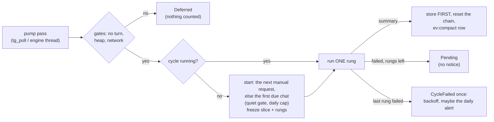

# The fold ladder and its driver

How the conversation summary (the fold) heals itself on every provider, from v5.1.2.
Read it when you change the fold, its schedule, or Summarize now. The owner's view is
[../compaction.md](../compaction.md); the summary's place in the device's memory is
[../memory.md](../memory.md#3-conversation-compaction---the-fold).

## Why

On 2 Nov 2026 three folds on Lumi failed in 95 seconds, all on the same host and
model, and the third paused automatic summaries. Nothing lifted the pause for 13 days.
Owner ruling 2 (15 Nov): the summary can never stay off for days again, a failure
walks every keyed provider, and the bound on cost is a daily cap, not a pause.

## One driver, two hosts

`agent::FoldDriver` (`lib/harness/{include/nimbus/harness/fold_driver.h,
src/fold_driver.cpp}`) is the only fold logic. The device's `compactTick()`
(`src/agent/orchestrator.cpp`) and the Virtual Nimbus's `foldTick()`
(`nimbusd/src/rig.h`) are bindings: they pass the clock, the network and quiet gates,
the trigger, the fold step, the slice, and where notices go.



Each pump pass runs at most one rung (one request plus that wire's own retry), so an
owner message waits at most one rung. A later automatic rung re-checks the owner-first
quiet gate; a manual one does not wait for quiet.

## The ladder

`TurnEngine::foldRungs()` (`lib/harness/src/engine_fold.cpp`), declared in
`fold_ladder.h`:

1. the head host on its fold model: the head model, or the host's non-reasoning model
   when the head is a forced reasoner (Mistral Large 4 folds on `mistral-small-latest`
   at effort none, orchestrator ruling of 16 Nov);
2. every other keyed, unparked, in-budget provider, in the owner's priority order, then
   any keyed provider the list leaves out (Cumulo only with a Cumulo key);
3. the router fallback (Cumulo, then Z.ai) when no provider key is set;
4. the head host on its Sub model (a direct host only; none for a forced-reasoner head, whose
   first rung already stepped down).

No rung ever runs a forced reasoner: lane W's live legs (16 Nov) found Large 4 folding on
itself cut at its fit (2,118 and 2,824 tokens) while Small folds fine, so on any rung (the
head, another provider, the Sub model) such a model is replaced by `mistral-small-latest`,
and on Cumulo's router `mistral/<forced reasoner>` by `mistral/mistral-small-latest`. A rung
on another model than the host's pick runs under a model pin (`ScopedModelOverride`): the
direct hosts and the Cumulo head read it, on the fold's own task only.
No (host, model) appears twice. A rung that answered empty or thin goes last in the
next cycle. A rung whose host left the ladder since the cycle started (parked, capped)
is passed over. Every failed rung logs one line the persona rig reads:

```
fold(<chat>): rung i/n <host>/<model> failed -> <kind> (<detail>)
```

with `<kind>` one of transport, timeout, 4xx, 402 park, 5xx, cut twice, empty, thin.
A success keeps `fold(<chat>): ok on <host> (...)`; a failed cycle logs
`fold(<chat>): cycle failed, next try <date time>`.

**The quality gate** (`foldAnswerThin`): for digests of 8 KB or more, a 2xx answer
shorter than min(800 B, 30% of the previous summary) or naming fewer than 2 of the
prompt's 5 sections (case-insensitive keywords) is thin: the next rung gets the job.
The matcher passes every live fold output recorded in
`test/support/fixtures/fold_outputs_2026-11/`. When every rung failed, and one or more
answered at least 800 B but named too few sections (a summary in another language, or
with renamed headings), the longest of those is stored instead of failing the cycle.

## Trigger and step

The fold reads lane B's request context for the head (`deriveRequestContext` over
`turnBudgetFor`, the head's turn budget in the form its turn goes out in; the VN on the
server link): `foldTriggerBytes(budget, compactAtKB)`
makes a chat due (0 off; 48, the default, the derived soft mark; another value that mark
clamped inside the history; on the floor branch v5.1.1's reading, compactAtKB KB) and
`foldStepBytes` is what one fold takes (on the floor branch v5.1.1's slice). The VN reads
`kHostedCompactKb` (48) the same way. A head whose turn is one flat prompt string (a
custom endpoint; Mistral or Z.ai with the tool loop off) is on the floor branch: the fold
keeps the tail that string can carry.

## The schedule (FoldStore and FoldCtl)

Per chat, in `/data/chatsum.txt` (`nimbus::orch::FoldStore`, `compact.h`):
`failedCycles`, `firstFail` and `nextTry`, written as `;` suffixes of the record's
failures field. The failures and pause fields themselves are always written `0`, so a
v5.1.1 image reads a chat that is neither failing nor paused.

| event | effect |
|---|---|
| a cycle fails | `nextTry` = now + 15 min, 1 h, 4 h, then 12 h; the next slice is half the last (floor 8 KB) |
| a summary lands | the failure count and a backoff wait clear |
| a refill within 2 turns of a fold (thrash) | due once, `nextTry` = now + 15 min; never a pause |
| a legacy pause (`paused=1` or `2`) | ignored on load: due on the first pass |
| a new firmware (`fwAtLastFail` differs) | every chat's wait and failure count restart |
| no clock | the wait is kept in RAM on the monotonic clock; paid requests count under day 0 in RAM, never over a real day's count; no alert |
| a wait longer than 12 h 15 min (the clock stepped back) | read as due |

Device-wide, in `/data/fold_ctl.txt` (`nimbus::orch::FoldCtl`; on the VN
`<data>/mem/fold_ctl.txt`): `paidDay` and `paidCount` (at most 12 paid automatic fold
requests a local day, every chat together; 2xx answers and timeouts after the upload
count, refusals do not), `lastAlertDay` (one owner alert a day, after 24 h of failing, sent to the owner's
Telegram chat or the web chat; another chat's is only logged),
`manualPendingChat` (up to 4 queued manual requests) and `fwAtLastFail`. Because this
lives outside the per-chat blob, evicting a chat's record (the blob keeps the 16 most
recently used chats inside 64 KB, about ten with a full summary) never resets the cap
or loses a request.

## Manual requests

`/compact`, `POST /api/fold/run` and the Memory page's **Summarize Now** stage the chat
(any task), and the pump moves it into `manualPendingChat`. Manual cycles run one at a
time, two minutes apart, skip the daily cap (they are counted in it) and the quiet wait,
and take a keep-0 slice. A manual request is a catch-up: while the chat still has rows
the history hides behind the anchor, its cycles chain oldest first (at most 64) and one
confirmation names the whole span. A manual request never waits behind an automatic cycle:
one that is between rungs when a manual request is ready ends uncounted, its failed
rungs going last. Every manual request is answered: the confirmation,
a failure with the next try time, or "Nothing to compact yet."

## Status

`FoldDriver::status()` and `foldStatusJson()` build `GET /api/fold/status`. The device
publishes a copy for the web task under a mutex whenever the driver's state moves and
every 5 s; the VN builds it on the engine thread. The CTX echo (`CTX?`,
`/api/test/ctx`) appends `nextTry`, `firstFail`, `rung`, `paidToday`, `cap` and
`queued`; `paused` is always 0.

## Summary size

The head's cap is lane B's `chatSummaryBytes` (`deriveRequestContext`): 6,144 B for a
request target of 60k tokens or more, else 4,096 B; a head whose turn is one flat prompt
string never takes the larger cap (the input names the larger budget in a
`[SUMMARY BUDGET]` line). `capSummary()` keeps every
section header and trims each body in proportion to its size, whole lines from the
end.

## Tests

| suite | what it holds |
|---|---|
| `test_orch_compact` | backoff, thrash wait, legacy lift, firmware reset, rollback round trip (the v5.1.1 parser), no reachable state stays off past 12 h, FoldCtl codec, trigger math, proportional cap |
| `test_fold_backlog` | a long chat's catch-up, a refill that only waits, a failure that schedules a retry |
| `test_fold_ladder` | every failure kind at every rung is answered by the next; no (host, model) twice; Large 4 on Small at effort none on the real wire; the matcher fixtures |
| `test_fold_driver` | Pending per rung, one CycleFailed, the never-lost manual request, keep 0, the device-wide cap, a failing week on five chats, no clock, fresh device, the Lumi blob folding forward with no id gap |
| `nimbusd/tests/test_fold_driver_vn` | the VN reaches the same outcomes as the device; the routes |
| `tools/release_gate/check_fold_health.py` | no reachable pause, fold control present, the blobs round-trip |

Live: `harness-lab --scenario foldladder` (one real fold per provider on a Lumi-shaped
digest of that host's fold step).
