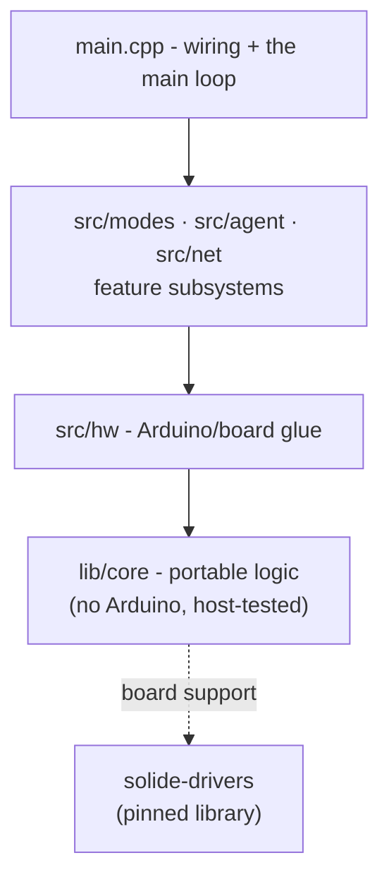

# Development guide

How to build, test, and change the firmware. Read it before your first change.
The ground rules for pull requests (licensing and the Developer Certificate of
Origin) are in
[CONTRIBUTING.md](https://github.com/ristllin/Nimbus/blob/main/CONTRIBUTING.md).

## Repository layout and the layering rule

Four layers; **a lower layer never includes an upper one**:



- `lib/core/` - portable C++, no Arduino, 100% host-testable. New logic goes
  here first whenever possible.
- `src/hw/` - glue binding portable logic to real hardware.
- `src/modes/`, `src/agent/`, `src/net/` - the feature subsystems.
- `main.cpp` - wiring and the main loop only.

Board support is the separate
[solide-drivers](https://github.com/ristllin/solide-drivers) repository,
consumed as a pinned PlatformIO library. Nimbus calls its `solide::` seams and
never forks its internals.

**Device builds** (`esp32s3`, `test`, and the rest) fetch it automatically from
the tag pinned in `platformio.ini`, so a fresh clone builds with nothing else.
**Host tests** (`pio test -e native`) need its headers from a sibling checkout at
`../solide-drivers`, at that same tag (an older tag fails on headers it does not
have yet). The first line below reads the pin from `platformio.ini`; the second
clones at it, and clones nothing if no pin is found:

```bash
SOLIDE_REF=$(sed -n 's|^[[:space:]]*https://github\.com/ristllin/solide-drivers\.git#\([^[:space:];]*\).*|\1|p' platformio.ini | head -n 1)
[ -n "$SOLIDE_REF" ] && git clone https://github.com/ristllin/solide-drivers.git ../solide-drivers \
  && git -C ../solide-drivers checkout "$SOLIDE_REF"   # the tag or commit platformio.ini pins
```

When the pin moves, re-run the `SOLIDE_REF=` line, then:

```bash
git -C ../solide-drivers fetch --tags && git -C ../solide-drivers checkout "$SOLIDE_REF"
```

Host tests also need a C++ compiler on the computer: the Xcode command line tools
on macOS (`xcode-select --install`), or `build-essential` on Ubuntu and Debian
(`sudo apt install build-essential`).

Driver developers can point the device builds at that same sibling by swapping
the commented `symlink://../solide-drivers` line in `platformio.ini`.

Every git dependency in `platformio.ini` (solide-drivers, AsyncTCP,
ESPAsyncWebServer) is pinned to an exact tag or commit, so a tagged clone builds
the same code from those libraries as the release did. Registry libraries
(ArduinoJson, NimBLE-Arduino) follow version ranges, so a later build can pick up
a newer compatible release. Bump a pin on purpose, in its own commit, once every
device environment still links.

## Build environments

| Environment | What it is |
|---|---|
| `native` | Host unit tests (Unity + golden images): `pio test -e native`. Keep it at 100% |
| `esp32s3` | Production firmware for the Solide S3 board: silent serial, no test or debug code |
| `esp32s3-cyd`, `esp32s3-cyd-35`, `esp32s3-cyd-40` | Production firmware for the all-in-one (CYD) boards with the 2.8", 3.5" and 4.0" displays |
| `test` / `test-cyd` | Production plus the serial test console, which the HIL suite drives |
| `testuart` | `test` with the console on the UART port instead of native USB |
| `notifierdbg` | Production plus a device-to-host status echo for Notifier end-to-end tests |
| `bttest` | `test` advertising as "Nimbus-BT" so a bench board is unambiguous |
| `provision`, `provision-uart`, `provision-cyd` | Standalone serial network diagnostic and installer seed tool |
| `beep`, `ledring`, `mictest`, `audio-cyd`, `tftmin`, `tfttouch`, `tftbringup` (some with `-uart` or `-cyd` variants) | Single-purpose hardware diagnostics |

`tools/build_all.sh` compiles the whole matrix: a compile-only gate before a
release. CI runs the same script (the `build-all` workflow) on pull requests and
pushes to `main` that touch a build input (`src/`, `lib/`, `include/`,
`platformio.ini`, `tools/harness-lab/`, or the script itself), and on a weekly
schedule, so an environment only this matrix compiles cannot rot unseen. The
full annotated list is in [Tools & commands](tools-and-commands.md).

## The verification ladder

"Compiles, links and boots" is **not** verification: that assumption once
shipped a build whose touch, Wi-Fi, and agent had never been exercised. Climb
the ladder:

1. **Portable logic** → `pio test -e native`. Fast, no hardware, must stay at
   100%. These are the C++ Unity suites in **`test/`** (one directory per
   module). Note the two similarly-named trees:
   **`test/`** is host C++ (this step); **`tests/hil/`** is the Python HIL suite
   (step 2); and the **`test` build environment** is a third thing again - the
   firmware plus a serial console the HIL suite drives.
2. **Device behavior** → flash `[env:test]` and run the hardware-in-the-loop
   (HIL) suite:

   ```bash
   python3 -m pytest tests/hil -m "hil and not manual" --allow-hardware   # device suite
   python3 -m pytest tests/hil -m "net and not manual" --allow-hardware   # LAN suite
   ```

   Markers (`hil`, `net`, `agent`, `audio`, `manual`, plus the gated
   `connectors`, `qa` and `destructive`) are all deselected by default, and
   hardware is additionally gated behind `--allow-hardware`, so collection stays
   clean with no device attached. Tests that break device
   state must restore it in a `finally`; manual tests must fail loud when
   unconfirmed.
3. **Anything user-visible** → assert it through the test console
   (`RENDER?`, `STATUS`, echoes) or hand it to a human as an explicit manual
   step.

Every observed field failure and the test that would have caught it is tracked
in the maintainers' failure catalog. Check the known open items before "fixing"
one.

## Golden tests (screens and protocol)

UI screens are pinned as **golden framebuffers** (RGB565) in `test/golden_tft/`:
the `*.bin` files at the root are the 320×240 2.8" baseline, and `480x320/` and
`480x480/` hold the larger displays. Each screen's tap targets are asserted next
to the pixels (`*.regions.json`): a target under 44 px, off the display, or
overlapping another fails the test. Several protocol and prompt surfaces have
golden text in `test/golden/`. The flow after an intentional screen change:

1. Run the native suite. The golden test fails and dumps the new render to
   `test/golden_tft/out/`.
2. Review it. One screen:
   `python3 tools/tftpreview.py diff test/golden_tft/<case>.bin test/golden_tft/out/<case>.bin diff.png`.
   The whole UI on one sheet:
   `python3 tools/tftpreview.py contact test/golden_tft/out sheet.png`.
3. If it looks right, re-bless with `GOLDEN_UPDATE=1 pio test -e native -f test_tft_render`
   and commit the new buffers with the change.

The nsn wire protocol is pinned the same way - `test/test_proto/nsn_vectors.h`
is generated from the reference encoder in
[nimbus-notify](https://github.com/ristllin/nimbus-notify) by
`tools/gen_nsn_vectors.py`, byte-locking the device codec to the broker.

## Pre-commit hooks

```bash
pipx install pre-commit       # or pip install pre-commit where pip allows it
pre-commit install
pre-commit run --all-files    # what CI runs
```

The hooks include secret scanning (gitleaks), repo-specific pattern checks,
a complexity gate (lizard - new code only; existing offenders are baselined),
formatting/whitespace hygiene, and ruff for Python. Generated outputs
(`website/docs/**` guides/reference, `docs/sfx-map.md`, the embedded docs
pack) are exempt from hygiene hooks - regenerate them, never hand-edit.

## Serial discipline (how not to wedge a board)

The ESP32-S3's native USB port is fragile in specific, documented ways:

- **Never strobe DTR/RTS.** Open ports quietly (both lines de-asserted before
  open) - see `tests/hil/device.py`. A DTR/RTS strobe can wedge the USB device
  silent.
- **Opening the port restarts the board** - even a quiet open. Hold one serial
  session across commands instead of reconnecting per command; prefer HTTP
  (`/api/state`) for polling.
- **Restart in software only**: the `REBOOT` console command, or the task
  watchdog (8 s timeout).
- A silent board is almost never bricked - see
  [recovery](quick-start/flash.md#recovery).

### Soak observability over LAN (`GET /api/state`)

Long soak legs read device liveness over HTTP so a serial open never resets the
board mid-run. `GET /api/state` carries these fields for that purpose (all are
read-only and present in both modes):

- `uptimeMs` - milliseconds since boot. Monotonic until the ~49.7-day wrap; a
  drop to a small value between polls means the device restarted.
- `ringBackstopFires` - times the ring backstop had to clear a stuck arc. Stays
  `0` on a healthy device; the wake-up soak asserts it never moves.
- `touch` - touch controller liveness: `failures`, `recoveries`, `busClears`,
  `hardResets` (monotonic counters), `consecFailures` (the current failure
  streak, `0` while comms is healthy), `lastRecoveryMs`, and `degraded` (true
  while the controller is not confirmed alive). On a capacitive (FT6336U) board
  the counters track the I2C recovery ladder; the sleep/wake soak watches
  `recoveries` climb while `degraded` returns to false. On a resistive (XPT2046)
  board the counters stay zero; a firmware liveness poll reads the raw controller
  instead and sets `degraded` plus `resistiveDead` when it sees the persistent
  stuck-high (all-`4095`) signature of a dead controller. The poll is skipped
  while the display is mid-frame (touch shares the SPI bus with the render task),
  and a skipped poll keeps the last verdict.
- `batt.rawPackMv` - the computed pack millivolts latched before the plausibility
  gate rejects it (diagnostics only, never a policy input). An open sense line reads
  near `0` here while a real pack reads ~`7000`, so the two can be told apart over
  HTTP even though both drive `batt.valid` to false. `0` on a board with no voltage
  sense.
- `batt.senseMissing` - true when battery monitoring is on, the reading has been
  invalid across a debounce window (an open sense divider), and a pack is known
  to have once worked (a valid sample since boot, or a persisted battery model
  built from valid samples). The detector runs every 30 s whether or not the
  sample is valid; three consecutive invalid checks claim the fault, about a
  minute into the invalid streak. It stays false on a desk-powered board with
  monitoring off or no pack history, and clears as soon as a valid sample
  arrives. The health report turns it into a "battery sense not detected" row.

## Docs follow every commit

Renamed or moved anything user-visible? Grep for the old wording and fix every
hit in the same commit (`README.md`, `docs/`, `website/docs/`, web UI copy).
Edited a published doc? Re-run `node website/scripts/migrate-docs.mjs` and
commit the regenerated `website/docs/**`. Edited a doc the on-device model
reads? Re-run `python3 tools/gen_docs_pack.py` and commit the regenerated
header. The [docs map](README.md) says which file is canonical for what.

## Hard-won constraints (do not relearn these on hardware)

- **No on-device sub-agent concurrency** - no worker task, no second
  concurrent TLS connection, no parallelism in the turn/sub-agent path. The
  single-task, single-TLS, fully-serialized design is deliberate and
  hardware-proven; every attempt at concurrency destabilized the device.
- **Internal SRAM is the scarce pool, not total RAM.** Route churn to PSRAM;
  never "fix" OOM by raising heap floors. See [Memory](memory.md).
- **Never DMA a full frame straight from PSRAM to the panel.** A ~150 KB SPI
  burst sourced from PSRAM shares the S3 external-memory bus and resets the
  ILI9341 (MADCTL to its power-on default), leaving the glass white while every
  register readback and the render task still look healthy. The color TFT driver
  stages a PSRAM frame band-by-band through an internal DMA bounce for this
  reason. `tools/check_tft_elf_no_eink.py` guards the companion property (a TFT
  build links zero GxEPD2, so the e-ink SRAM win survives).
- **The two USB-C ports are not interchangeable** - a factory-fresh board
  flashes only through `UART`. See [Flash the firmware](quick-start/flash.md).
- **Structured outputs everywhere** - never ask a model for JSON in prose.
  See [Provider wire](provider-wire.md).

---

*Forking the project and running your own update channel →
[Self-hosted OTA](self-hosted-ota.md)*
