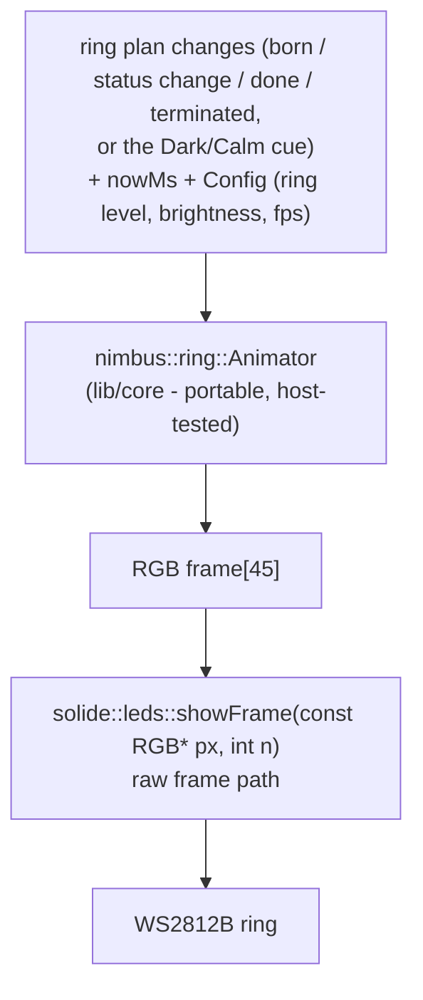

<!-- audience: user -->
# The LED Ring - Motion and Color

This page explains how to read the LED ring: what each color, motion and
brightness level means, how the ring level changes what plays, and how long a
state stays lit. Use it when the ring does something you did not expect, or
when choosing a battery mode and ring level.

The short version: **color says what, motion says whether it is live,
brightness says how much it matters.** A sliding comet is work in progress; a
slow breathe is something waiting on you; a still, settled ring means handled.

Three design principles behind everything below:

1. **Nothing pops.** Every appearance, change, and disappearance is a short
   transition (150-400 ms), never an instant swap.
2. **Motion means work; stillness means rest.** Anything moving is *happening
   now*.
3. **Color is meaning, brightness is urgency, motion is life.**

## Reading the colors

| Meaning | Color (from your theme) | Used for |
|---|---|---|
| Running / thinking | the theme's primary color | active jobs |
| Waiting for you (input) | the theme's needs-you color (cool, next to the primary) | your turn to answer |
| Waiting for you (approval) | the theme's approval color (amber-leaning) | permission gate |
| Done / success | the theme's done color (green-leaning) | completion |
| Error | the theme's alert color (red is reserved for errors) | failures, critical battery |
| System / neutral | white | boot, idle |

Status drives both the color and the motion: each status maps to a role in your
theme, and an idle session stays neutral white.

The exact hues follow your **theme**: each theme maps the status roles to its
own color family, and changing the theme recolors the ring live. The
status → role mapping and the theme rules (red reserved for errors, roles
hue-distinct) are in
[Modes & signals §5](./modes-and-signals.md) and the full specification,
[Notifier status language](./notifier-status-language.md).

## What you'll see - the job lifecycle

Every session on the ring is an arc, and every moment of its life gets motion:

| Moment | Motion | Why |
|---|---|---|
| **Birth** (new session) | arc **grows** from 1 LED to full width (~350 ms), easing in from dim to full brightness in its status color | "a new thing began" - brief, never a flash |
| **Status change** | **crossfade** the segment old → new hue (~250 ms) | continuity, never a jarring recolor |
| **Progress** | not shown on the ring (the screen shows it) | status, not a bar |
| **Attention arrives** (input/approval/error) | the arc **crossfades** into the attention color (~250 ms), then **breathes** steadily (~2.6 s cycle) | "look here," sustained without a flash |
| **Completion** (done) | a bright **success ripple** in the theme's done color sweeps the arc → fades to a dim ember | earned closure |
| **Termination** (offline) | arc **contracts** back to a point and winks out (~350 ms) | graceful closure, symmetric with birth |

And smaller, transient feedback:

| Moment | Motion |
|---|---|
| Cursor moves (menu navigation) | soft **trailing comet** follows the cursor LED, decays after the dwell |
| Setting saved (a web Wi-Fi save or scan, or a device-menu action) | a brief soft pulse of the whole ring: the theme color for a web action, green or red for a menu action's success or failure (never in Dark) |
| Voice: listening | breathe in the theme color (the all-in-one's on-screen ring holds steady) |
| Voice: processing | sweeping spinner from the moment you release the button until the reply lands |
| Voice: speaking | solid in the theme color |
| Voice: no network | the theme's alert color, breathing, for 15 seconds (a tap clears it sooner) |
| Voice: other failure | the theme's alert color, steady, for 15 seconds (a tap clears it sooner). "Didn't catch that" shows no alert |
| Low battery (first warning) | nothing by default; with the **Low-battery light** setting on, a dim pulse in the theme's alert color for about 3 seconds each minute, giving way to any job that needs you (in Full, to any session arc) |

## How the ring level changes the language

The [ring level](./modes-and-signals.md) (Dark / Calm / Full - each battery mode
binds one as its default) decides how much of this vocabulary plays:

- **Dark:** the ring stays off. Only a failed job lights it, as a dim breathe in
  the alert color over the whole ring. Jobs that are running, done, or waiting
  for you show nothing until you single-click to reveal them, and births,
  deaths, and ripples are not shown. (Voice cues and the optional Low-battery
  light still show.) Quiet by design.
- **Calm** (Balanced default): the ring stays dark except for one dim cue over
  the whole ring. It breathes in the attention color when a job needs your input
  or approval or has failed, breathes softly in your theme color while a session
  is working (a Notifier session running, or an Orchestrator turn), and glows a
  steady green for a finished session until it ages out. It returns to dark once
  the sessions clear. One exception, Orchestrator only: while sub-agents are
  running, Calm shows the same per-session arcs as Full, at Calm's brightness,
  and returns to the single cue as they finish.
- **Full:** the full motion language above. When **idle** (no jobs, no voice)
  the ring goes **fully dark** - an all-day desk ring shouldn't glow with
  nothing happening. A call for your attention or a single-click reveal still
  lights it, and a real job lights instantly at full brightness.
- The battery mode's **brightness cap** scales everything; in the Dark battery
  mode the whole language runs dimmer and slower (longer cycles, fewer FPS).

## How long a state lingers

The broker sends a frame on every change, not continuously, so a quiet ring is
normal between events. What lingers is deliberately split so a call for your
attention can't be lost while ambient noise still clears:

- **Ambient** states (running / done / idle) expire on a clock scaled to the
  ring level after the link goes quiet: **Full = 5 min** (a desk display stays
  lit), **Calm = 30 s**, **Dark = 5 s** (battery-frugal). A dead session
  shouldn't leave a stale ring, but a desk shouldn't blank every few seconds
  either.
- **Calls for your attention** (waiting for input / awaiting approval / error)
  are what you must not miss, so they hold well past the ambient cues - **1
  minute in Dark, 2 in Balanced, 5 in Full**, each tunable in Customize - and
  keep animating the whole time. A job waiting on *you* never vanishes just
  because the broker stopped re-sending.

## Wake the ring - the single click

A **single click** briefly wakes the ring: for ~4 s it promotes **any** ring
level to the full-brightness segment treatment, so you can glance live status
on demand - even from a fully dark idle ring. It then decays back to normal.
(Double-click still opens the menu in Orchestrator; long-press is the menu in
Notifier / hold-to-talk in Orchestrator.)

## Whole-ring system states

Boot and idle are live. The other rows are design targets that are **not
implemented**; do not cite them as current behavior.

| Moment | Motion | Status |
|---|---|---|
| **Boot / waking** | white breathe (about a 2 s cycle) at the ring's brightness for the first ~2.5 s after a start; any job or call for attention ends it early | **live** |
| **Idle** | dark in every ring level; a needs-you cue or a single click still lights it | **live** |
| **Connecting** (Wi-Fi/Bluetooth) | dim white comet, brightness building as it retries | *design intent, not wired* |
| **Connected** | one quick bright green flash (150 ms) → fade to idle | *design intent, not wired* |
| **Connect failed / no credentials** | slow amber double-pulse, then rest | *design intent, not wired* |
| **Setup mode** (unconfigured) | slow rainbow drift, dim - pairs with the sign-in QR | *design intent, not wired* |
| **Entering deep sleep** (critical battery) | inward collapse to the top LED, then off | *design intent, not wired* |

Why the "not wired" rows exist

These states were designed but never driven by production code, and the LED
overlay for them was removed so this page would not read as implemented. The
boot and connect *audio* cues are live (link sounds when Wi-Fi gets an address
and when Bluetooth connects); the LED equivalents stay here as the design
target for if and when they are wired.

---

## For developers - architecture and status

`solide::leds` exposes fixed **Patterns**, an **agent-segment** API, and a raw
frame path, `showFrame()`, which the Animator uses to render the transitions
above. The seam:

- **The Animator is portable and host-tested**: it holds per-segment animation
  state (phase, start time, from/to color, motion, brightness) and, outside Full,
  the one dim whole-ring cue, and on `frame(nowMs)` computes all 45 LEDs. Deterministic (the
  clock is passed in), so tests assert exact LED colors at chosen times during
  a birth grow-in, a death collapse, a crossfade midpoint, a success ripple -
  the golden-frame equivalent for the ring.
- **Device glue is thin**: feed it the same router/notifier events the ring
  already gets, call `frame()` at the profile FPS, push to `showFrame()`.
- **Raw frame path**: `solide::leds::showFrame(RGB[], n)` sits alongside the
  pattern/segment renderer. A raw frame outranks the segment renderer while it
  is held, and the driver drops a raw frame that is not re-pushed within about
  500 ms, so the loop re-pushes the current frame every pass.

**Status:** the job-lifecycle transitions (birth grow-in, hue crossfade, done
ripple, termination collapse) are implemented in `lib/core` `ring::Animator`
(see `test_ring_animator`) and render on the device through `showFrame()` in
every ring level. `ring_plan` (Dark/Calm cue vs Full segments) remains
the *steady-state* decision layer; the Animator is the *motion* layer that
renders those decisions with transitions between them. The whole-ring system
states above are the part still at design stage.

### Candidate "working" animations

The processing slide is the one animated steady state the ambient grammar allows, and
it has five candidate looks behind a selector (`nimbus::ring::RunStyle`): comet with a
fading tail (the default), comet with sparse trailing sparks, a dual comet, a breathing
arc, and fireflies. Each is a deterministic function of `(nowMs, arc geometry)`, so the
LED ring, the on-screen ring, and the web simulator render identical frames; the host
suite `test_ring_styles` pins the frame invariants (fail-dark, no stray pixels after a
retire) for every variant. Preview and compare them in the self-contained page
`tools/ring_ab_demo.html` (it ports the device math one-to-one), or drive them on real
hardware with the test-console `RINGANIM 0..4` command. The device default stays the
comet until a variant is chosen.

### Keeping the head arc honest (wake-ups)

The orchestrator paints a "head" arc while a turn runs and holds it while that
turn's sub-agents run (`nimbus::harness::HeadArcTracker`, host-tested in
`test_head_arc`). The main loop reconciles it every few seconds. A short wake-up
turn can start and finish *between* two of those ticks, so the tracker never sees
it in flight; the tracker also watches the engine's monotonic turn counter, so a
completed-turn edge still tells it to clear an arc a finished turn may have left
lit. Additional backstops (a frozen-children latch, the stuck-turn reaper, an
absolute working-breathe ceiling) exist only as insurance. In a healthy system
the primary edge always clears first, so `ringBackstopFires` in `/api/state`
stays **0**; a nonzero value means a stall got past the primary path and is
worth investigating.

### Nothing lit outlives its job

A turn's arcs are armed and cleared on the poll task (the head arc in the turn
guard, a sub-agent's arcs as its job runs). The always-alive main loop is the
safety net for when that task stalls, and the rule it enforces is simple: **every
ring status has a main-loop terminating edge**, so nothing can stay lit after the
work behind it is gone.

| Ring status | What lights it | Main-loop terminating edge |
|---|---|---|
| Waiting / Approval / Error | a job that needs the owner, or failed | attention watchdog ages it out past the attention hold |
| "Needs you" ask | the assistant asked a question | same attention watchdog (the ask's own dwell clock) |
| Head "working" arc | a turn (and its sub-agents) running | the stuck-turn reaper + the head-arc reconciler |
| Done | a finished sub-agent's fading arc | the Done reaper collapses it past the same hold |
| Offline | (terminal) | frees the segment immediately |

The Done row matters because a finished sub-agent's arc is a dim ember that the
poll task normally collapses a moment after the result ripples; it is not an
attention status, so without its own main-loop edge a stalled poll task would
leave it lit. Every one of these clears counts into `ringBackstopFires`, so a
healthy device still reads **0**.
