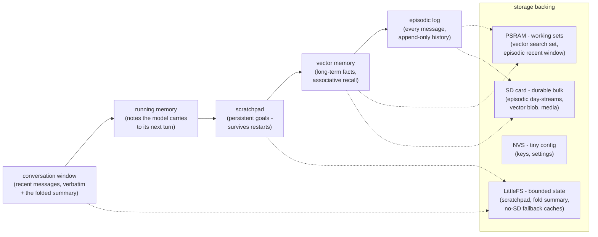
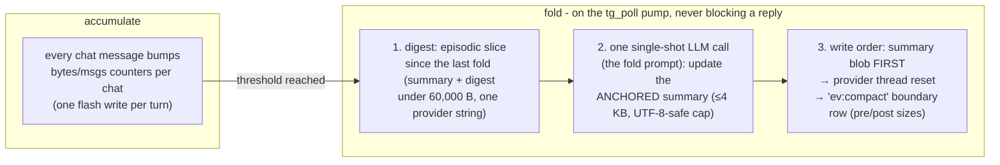

# Memory: RAM Pools, Turn Budget, and Compaction

How Nimbus fits a memory-hungry agent into a microcontroller. Read this before
changing a heap floor, a buffer size or a context budget. It covers the two RAM
pools and which one is scarce, what a live turn costs in internal SRAM and how
that stays bounded, and how long conversations fold into a compact summary
instead of growing without limit. It reads from the hardware up to the
conversation.

Related: [orchestrator-storage.md](orchestrator-storage.md) (what lives on SD,
PSRAM, NVS, and flash), [turn-anatomy.md](turn-anatomy.md) (what the model
sees), [provider-wire.md](provider-wire.md) (the wire mechanics per provider).

The memory tiers at a glance - information flows left to right from the
shortest-lived tier to the most durable, and each tier is backed by the
storage that fits its lifetime (details: §1–§3 below and
[orchestrator-storage.md](orchestrator-storage.md)):



## 1. The two pools (read this before touching heap floors)

The Solide S3 board is an **ESP32-S3-DevKitC-1 N16R8**. It has **two very
different memory pools**, and conflating them has repeatedly caused work to be
throttled or deferred while most of the device's RAM sat idle. Know which pool
you mean.

| Pool | Size | Speed | DMA | What reports it | Character |
|---|---|---|---|---|---|
| **Internal SRAM** | ~266 KB heap (of 512 KB total; the rest is static/ROM) | Fast | Yes | `ESP.getFreeHeap()`, `heap_caps_*(…, MALLOC_CAP_INTERNAL)` | **Scarce**: the real constraint |
| **PSRAM** (external, octal) | **8 MB** | ~2–4× slower | Limited | `ESP.getFreePsram()`, `heap_caps_*(…, MALLOC_CAP_SPIRAM)` | **Abundant**: normally ~98% free |

**`ESP.getFreeHeap()` measures internal SRAM only.** A reading of 16 KB free
means the scarce pool is low, not that the device is out of memory: PSRAM
typically has ~8 MB free at the same moment.

### What MUST live in internal SRAM (do not try to move these)

- **FreeRTOS task stacks** - every `xTaskCreate*` stack is internal *by default*.
  A task that touches flash (NVS / LittleFS / `esp_partition` reads) or runs in an
  ISR cannot use a PSRAM stack. TLS itself does **not** force an internal stack: the
  prebuilt Arduino core already enables ext-mem stacks
  (`CONFIG_FREERTOS_TASK_CREATE_ALLOW_EXT_MEM`) and the mbedTLS record buffers already
  live in PSRAM, so `tg_poll`'s stack is internal because it reads NVS/config, not
  because it runs the handshake. The gate is flash access, not TLS.
- **DMA buffers** - Wi-Fi, I²S, SPI (display/SD), LED RMT. These request
  `MALLOC_CAP_DMA` explicitly and bypass the PSRAM spill entirely.
- **lwIP pbufs + the TLS record working set** - the ~24 KB "danger zone." A
  network call needs this much *contiguous-ish internal* to not fail; it is
  the real internal red line.

### What IS routed to PSRAM already (don't duplicate)

Installed in `main.cpp` at boot:

- **mbedTLS allocator → PSRAM** (`mbedtls_platform_set_calloc_free`): the big
  RX/TX content buffers (~16 KB each) + session/cert parse land in PSRAM. The
  ~40 K contiguous handshake that used to fail at ~50 K internal now lands in
  PSRAM.
- **General malloc/`new`/`String`/JSON churn ≥ the spill threshold → PSRAM**
  (`heap_caps_malloc_extmem_enable(N)`; currently **N = 128 B**). Allocations
  `< N` stay internal to keep hot paths fast; `≥ N` go to PSRAM. **Lowering N
  frees more internal** at a small PSRAM-speed cost - this alone took internal
  free from 16 KB → ~48 KB and made Telegram turns run (they had been
  deferring at the 34 KB floor).

Also PSRAM-backed by design: the vector-DB working set
(`setWorkingAllocators`), ArduinoJson node pools (`ps_json.h`) - including the
single-shot turn response docs - per-adapter request/response bodies
(serialized into one contiguous PSRAM-spilled string and written once), the
SFX manifest, the web audio test-tone buffers, minimp3's ~15 KB per-frame decode
scratch (via `mp3dec_decode_frame_ex`; it used to sit on the audio task stack,
forcing the sfx task to 20 KB and leaving the 8 KB music task one MP3 track short
of an overflow), and the Telegram poll body plus the poll task's staging buffers
(the inbound-drain slot and the shared API response scratch). The last two are
safe in PSRAM because `tg_poll` is their single consumer and its TLS work is
fully serialized, so a batch never needs two of either live at once - moving them
off internal freed ~6.7 KB of the scarce pool with no behavior change.

Long-lived fixed buffers that would otherwise be file-scope statics in internal
`.bss` are declared through `nimbus::psramStatic<T>()` (`src/sys/psram_static.h`):
`static T& g_x = nimbus::psramStatic<T>();` keeps every use site and `sizeof`
unchanged, starts the object zeroed like a static, and leaves only a 4-byte
reference in internal RAM. It applies only to task-context data: never a buffer an
ISR, IRAM code or DMA touches, and never the spinlock itself (the lock stays
internal, only the data it guards moves). This holds the web model-memory echo,
the fold status echo, the system-turn prompt, the large OAuth handoff buffers and
the Telegram pending slots (voice, attachment, media, unknown-chat approvals): about
6.3 KB that v4.5.14 had added back to static internal RAM.
`tests/hil/test_psram_statics_host.py` fails if one moves back inline.

Moving the MP3 scratch to PSRAM let the sfx task stack drop from 20 KB to 12 KB and
made the 8 KB music task safe. Measured on the Solide S3 in Orchestrator mode with
Wi-Fi up, that returned about 9 KB to the internal free pool: total `intFree`
59.2 KB to 68.3 KB and the `heapMin` floor 49.0 KB to 57.9 KB. The *largest
contiguous* block (`intLargest`, 31.7 KB) did not move, because the freed stack
region is not adjacent to it; the gain is in total free and `heapMin`, which is
the "low internal SRAM" headroom. `/api/state` reports the audio task high-water
marks as `mem.sfxStackMin` and `mem.musicStackMin` alongside `pollStackMin` /
`asyncStackMin`.

### A deliberate exception: the episodic deep-history read stays internal

Not every transient belongs in PSRAM. The episodic **deep-history** search
(`memory.episodic` cold-scan, `GET /api/mem/episodic?cold=1`) reaches history
that sits on the SD card below the boot-scan index by walking the day-streams
backward, one small window at a time, on the **querying task** - the AsyncTCP
web task or the turn task, each of which runs on a tight internal stack. That
read window is a heap allocation on that task, so its size is a **crash
boundary, not a performance knob**: a large window (an early design used
128 KB) starves the task's contiguous internal SRAM and drops the device off
the LAN mid-query. It is kept small (≈8 KB, escalating only when a single
record is longer than the window). What bounds the work is the **per-call read
budget** (a few files, ~128 KB total) - not a big buffer - so deep history
*pages*: the store returns a resume cursor rather than allocating for the
whole scan. This is the counter-lesson to "route churn to PSRAM" - a small
bounded internal read on a stack-tight task is the correct shape. Full design:
[`orchestrator-storage.md`](orchestrator-storage.md) §3a.

The **word match** every text search runs (`nimbus/orch/lexical.h`) holds to
the same shape: the parsed query is a fixed ~220-byte value on the querying task's
stack, each row is scanned in place (no lowercased copy, nothing allocated per row),
and a ranked page adds one score byte per kept row - at most 200 bytes of heap.
`test_orch_lexical` counts heap allocations and fails if matching or a no-match store
scan makes any.

### The heap floors are internal-only guards, not a whole-device budget

`agent_config.h` defines `ORCH_TURN_HARD_FLOOR` / `ORCH_AUTO_TURN_MIN_HEAP` /
`ORCH_DISPATCH_MIN_HEAP` / `ORCH_RECALL_MIN_HEAP` / `ORCH_LOOP_MIN_HEAP`, plus
`provider_verify`'s `VERIFY_MIN_MAX8` and the `/api/tools` async-stack guard.
They all gate on **internal** heap. Because the heavy allocations they used to
protect are now on PSRAM, a turn's true internal cost is small transients plus
the lwIP/TLS working set, so admission has two parts:

- A **total-free backstop** of 12 KB for a user turn, a dispatch, a loop round
  and recall (`ORCH_TURN_HARD_FLOOR`). Background synthesis is held 2 KB higher
  so it yields to a live turn.
- A **largest-block guard** of 5 KB (`ORCH_TURN_MIN_LARGEST_BLOCK`): the
  contiguous internal block one mbedTLS handshake needs. This is the real gate.
  A fragmented but ample heap passes; an obviously starved one is refused.

A `static_assert` keeps the turn floor below the pre-PSRAM 28 KB danger zone and
the background floor above the interactive one.

**Do not re-raise these floors to "survive with no PSRAM".** PSRAM is present
and carries the churn. If turns are deferring ("low on working memory") while
PSRAM is free, move more internal churn to PSRAM (lower the spill threshold)
rather than raising the floor. A turn that still runs out of memory fails soft:
an honest low-memory reply ("the device ran out of working memory for this
request; try a shorter question or wait a minute"), no restart. On every head
running the tool loop (the default; the Cumulo router head and a direct OpenAI,
Anthropic, Mistral or Z.ai head alike), a request the device could not finish
sending is sent once more, on the same provider, after the heap recovers past
the round floor (a bounded wait of up to 3 s); only if it does not recover does
the turn end with that reply, without switching to another provider (the request
would run short the same way there). A request that went out is never sent a
second time this way. A turn that starts with too little heap for the tool loop
runs single-shot instead, and a failed send there gets the turn's ordinary
retry, then another provider.

### Admission beside a turn

The floors admit a turn on one sample at round start. Other consumers of internal
SRAM run beside it, so they yield instead of re-raising the floors:

- **Worker tasks** (provider verify, cloud key mint, voice catalog, safety report)
  start only with room for their stack plus 16 KB of internal free, and never while a
  turn is in flight (`heapwatch::spawnGate`). A verify refused for a turn starts when
  the turn ends; one refused for memory is recorded as deferred and retried, early
  once the resting largest block recovers. The verify's memory gate reads the
  **resting** largest block (the minimum of the last idle samples), taken before its
  stack exists: a sample inside a transient read 7,156 B on a device resting at
  15,860 B.
- **Big web responses** (over 16 KB: the web app page, file downloads, log files,
  stored blobs, episodic and vector pages) trickle, about two TCP segments in flight
  per connection, or answer 503 with Retry-After when internal free is under 20 KB.
  The cloud relay's own loopback request also gets the 503 while a turn is in flight
  (the cloud page retries it); a LAN browser trickles. Bodies up to 16 KB are served
  as before.
- **The cloud relay** dials and writes responses over 8 KB through the TLS work slot
  (see [the live turn](architecture/orchestrator-live-turn.md)).

A failure is memory-caused only on evidence: an allocation failed during the
exchange (its error says `alloc failed`). Then the turn never switches to another
provider and gets no retry (the LowMemory row of the provider failover table),
except the one resend above for a request the device could not finish sending.
Without evidence the rule above holds: a fragmented but healthy board's outage
still fails over.

### Levers to free internal SRAM (biggest first, verify on-device)

1. **Route Wi-Fi/lwIP buffers to PSRAM** (`CONFIG_SPIRAM_TRY_ALLOCATE_WIFI_LWIP`,
   Wi-Fi static-buffer counts) - potentially the largest single win; needs an
   `sdkconfig.defaults`.
2. **Lower the malloc spill threshold** (`heap_caps_malloc_extmem_enable`,
   main.cpp).
3. **Right-size / statically-place buffers** (framebuffers, static arrays)
   into PSRAM.
4. **Re-anchor over-conservative internal floors** (above, done).

### How to measure (don't guess)

`ESP.getFreeHeap()` = internal free; `ESP.getFreePsram()` = PSRAM free.
`/api/state` reports both (`heap`/`heapMin` vs `psramFree`/`psramTotal`) and
`/api/health` lists PSRAM as its own row. For an internal-vs-PSRAM-vs-DMA
breakdown, read the `mem` object in `/api/state` (`intFree`, `intLargest`,
`dmaFree`, `spiFree`, `spiLargest`), or call `heap_caps_get_free_size()` and
`heap_caps_get_largest_free_block()` once per pool (`MALLOC_CAP_INTERNAL`,
`MALLOC_CAP_SPIRAM`, `MALLOC_CAP_DMA`). The caps are ANDed, so ORing two pools
returns 0.

Point samples miss the real low points (inside a TLS write, a handshake, another
task's serve), so the device also keeps evidence of its own:

- `mem.lowWater`, `mem.lowWaterTags`, `mem.lowWaterUp`: the lowest internal free
  since boot, what was running when it was set (`turn`, `relay.dial`, `relay.bulk`,
  `tunnel`, `tg.dl`, `vision`, `stt`, `ota`, `dream`, `verify`, `worker`, `lan.big`),
  and the uptime in seconds. Each new low at least 1 KB down, once under 24 KB, logs
  `heap: new low-water <n> (was <n>) free= largest= tags= up=`.
- `mem.allocFails` and `mem.allocFailLast`: allocations that failed since boot (any
  task), and the newest one. Each logs `heap: alloc FAILED size= caps= task= free=
  largest= up= count=` (a few lines a minute; the count stays exact). The records live
  in RTC memory, so after a panic, watchdog or software reset the next boot logs
  `heap: <n> alloc failure(s) before the last reset` with the newest records.
- `mem.restingLargest`: the largest internal block at rest (the verify gate's input).
- `mem.tlsOverlaps`: concurrent work-TLS seen (it stays 0 under the single slot).
- `mem.loopStackMin`, `mem.panelStackMin`, `mem.vrelStackMin`: worst free stack of
  the main loop, the display render task and the voice-release watcher.
- Every provider exchange logs one `transport: heaptrace` line on every path, with
  the heap at four phases and `fail=` (where it stopped: `connect`, `head`,
  `body@<bytes sent>`, `read`, `headers`, `parse`, `none`), `af=` (failed
  allocations during it), `min=` (its local minimum free) and `at=`/`ms=` (when it
  held the TLS slot). The body goes out in 4,096 B slices, so a failed write says
  how many bytes left.

## 2. Heap under a live turn - what's movable, what isn't

A live orchestrator turn runs with only **~47 K free *internal* SRAM** (TLS +
lwIP + the orchestrator all resident). PSRAM is nearly empty but is **not** in
the default malloc pool by default. What is already in PSRAM is listed above;
this section records what is stuck internal, and why (measured while chasing
the heavy-connector-write restart, 2026-07).

### What is STILL internal (and why)

- **lwIP RX pbufs** - inbound TLS/socket data queues as pbufs in
  `MALLOC_CAP_INTERNAL/DMA` by design; the extmem hook cannot move them. This
  was the dominant internal spike when the device buffered a whole large
  response. **Mitigation: streaming.** The transport stream-parses the
  response off the socket (`transport_tls.cpp` `execJson` →
  `deserializeJson(doc, BlockingClientReader, Filter)`), so pbufs drain
  continuously as the parser pulls bytes instead of piling up while a whole
  body is buffered. This is the real fix for the heavy-connector-write
  restart.
- **Small (< 128 B) allocations** - stay internal by the extmem threshold;
  cheap and not worth lowering the threshold (churn).
- **FreeRTOS task stacks** - e.g. `tg_poll` (24 KB, `POLL_STACK_BYTES`), which
  runs the whole turn. Internal by nature. The response parse is bounded to
  `NestingLimit(64)` (`kResponseNestingLimit`), well within this stack.

### The size-transparency contract

The harness must handle any response / context / file size without crashing:

1. **Responses stream** off the socket; only filter-retained fields are stored
   (a 128 KB wire body → < 4 KB retained doc - `test_harness_streaming`). What the
   filter keeps is capped at 512 KB (its serialized size, `kMaxRetainedBytes`): past
   it the answer is dropped and named "response too large for the device" (Cut in
   the provider failover table). A parse that ran out of memory while a failed
   allocation was recorded is low memory instead: no retry and no switch.
2. **Tool results into the model are clamped** (derived from the head model's
   context window: 8 KB per result and 64 KB total at a 200K window, see
   "Derived context budgets" below), so context stays bounded.
3. **Heavy connector work is offloaded** to a sub-agent on the connector's
   provider (the orchestrator is guided to; routing in `jobs.cpp`), so the
   device only ever ingests a short result.
4. **Large payloads spill to SD** (the artifact store) rather than transiting
   RAM or the model's context.

### Do NOT

- Do not raise the turn heap floors to "fix" out-of-memory errors. The fix is
  streaming plus PSRAM routing, not gating turns out (the historical 34 KB floor
  deferred healthy turns; the live backstop is 12 KB with a 5 KB largest-block
  guard).
- Do not buffer a whole provider response then parse - stream it.
- Do not put connector write content through the model's context -
  offload/spill.

## 3. Conversation compaction - the fold

How the device keeps long conversations fast, cheap, and continuous: when a
chat accumulates enough history, the device summarizes it into a compact
per-chat memory (the **fold**), resets the provider-side thread, and keeps
going - nothing the owner said is lost, and every future turn carries the
summary instead of an ever-growing transcript.

### Owner's view

- **When it happens**: automatically, after roughly 48 KB of conversation on a
  chat since its last fold (knob: `compactKB`, 8–512, 0 turns auto-fold off),
  after 200 distinct messages, or once the recent history has outgrown its
  budget - and only when there is something new to summarize. The same message
  arriving again and again (a re-sent or replayed update) counts once, so a
  flood of one line never costs a summary. Or on demand with the **`/compact`**
  command (owner-only, also listed in /help).
- **What you see**: automatic compaction is silent - its record is the
  "Conversation compacted: … folded into a … summary" row in the chat history.
  A manual `/compact` acknowledges immediately and then confirms with
  "✓ Compacted." (or tells you it couldn't, with the next step). The web chat
  never gets notices (they would desync the reply pairing).
- **What changes**: nothing you'd notice in conversation quality - the recent
  turns stay verbatim in the model's context, the summary carries everything
  older, and long-term facts were already in vector memory. What improves:
  turns stop getting slower and more expensive as a chat ages.
- **If a provider is down**: the fold tries the device's other configured
  providers before counting a failure (the same order turns use), so one
  provider having trouble doesn't stall compaction - or message you about it.
  A provider that refused for credit or its key is skipped until that is fixed,
  the same as for turns.
- **If it keeps failing**: after 3 consecutive failures (or a fold that
  refills immediately), automatic compaction pauses for that chat and you get
  ONE alert; `/compact` always remains available and un-pauses it.

### How it works (the design, in one page)

The device cannot edit provider-side conversation threads (they're opaque
ids - and only OpenAI even has a cross-turn thread; Anthropic is stateless and
Mistral's tool-loop mode starts fresh every turn). So compaction is built on
the device's own episodic store, provider-uniformly:



- **Trigger** (`FoldStore::evaluateDue`): bytes-since-fold ≥ `compactKB` OR
  ≥200 distinct owner messages (`noteOwnerMessage`: the same text right after
  itself counts nothing) OR rows the history's overflow shift hid that no
  summary covers yet - provider-independent by design. A reactive path also
  classifies real provider context-overflow errors (`isContextOverflowError`)
  and queues a fold; the turn itself recovers via the existing fresh-thread
  retry.
- **The anchor and the slice** (turn-structured history): the summary records
  the newest row it covers (`thru`), and the history starts after it. A fold
  digests only the turns after the previous anchor that lie beyond the kept
  verbatim tail (half the history budget), repeats collapsed to one line with a
  count; when that slice is under 1 KB there is nothing worth a paid call and
  the fold is skipped. A manual `/compact` digests every turn.
  The anchor and the overflow shift ride the fold blob as suffixes of its
  numeric fields, which an older image's parser stops before.
- **The fold call** (`TurnEngine::runFold`) is deliberately NOT a turn: no
  delivery, no recall, no tool loop, no conversation-map writes, no capture of
  the summary as chat history - the model's reply IS the summary and every
  other field of its output is structurally inert. It has its own output
  budget: on Anthropic the request offers no tool (the summary comes back as
  text), thinks at low effort, and a summary cut at the limit gets one retry
  with more room. The digest is bounded so summary plus digest stay one whole
  provider string (ArduinoJson stores a 64 KB string as null). Its spend is metered under
  the `compact` attribution (never a routine's budget). Gates (low heap, over
  budget, turn in flight) **defer** - only a real failed attempt counts
  against the breaker.
- **Anchored, not cumulative**: each fold UPDATES the previous summary with
  the new slice (opencode's pattern), so fold cost stays bounded forever. The
  summary re-enters every prompt as `## CONVERSATION SUMMARY` - explicitly
  framed as *information, not instructions*, and instructions found inside
  tool outputs are folded as data, never preserved as directives (prompt-
  injection posture).
- **Summary + verbatim tail**: the summary sits directly above the RECENT
  CONVERSATION window, the shape every surveyed harness (Claude Code, codex,
  opencode, aider) converged on. Under prompt-budget pressure the summary is
  sacrificed BEFORE the window (the tail is the fresher signal).
- **Durability & rollback**: all fold state (summary, counters, breaker) lives
  in one tolerant-load LittleFS blob (`/data/chatsum.txt`, LRU-16 chats). The
  NVS conversation map is untouched, so an OTA rollback to pre-v3.6 firmware
  simply ignores the file - rollback-safe by construction. Crash mid-fold:
  the write order (summary first, thread reset second) means the worst case is
  a fold that re-runs, never a lost summary with a reset thread.

### Verification

Host: `test_orch_compact` (trigger math, breaker, thrash guard, codec,
UTF-8-safe caps, fold-prompt contract, the anchor and shift round trip, a
repeat counted once), `test_harness_chatwindow` (the fold slice: 500 identical
messages never fold, 200 distinct 30-byte lines do), `test_harness_history`
(the slice starts after the anchor), `test_harness_turn` (runFold's
no-side-effects contract incl. a hostile summary carrying device actions -
inert), `test_harness_compose` (§5a placement + budget-pressure drop).

Hardware: `tests/hil/test_l16_compaction.py` -
the full cycle with a marker planted OLDER than the verbatim window, proving
recall comes from the summary (`/api/lastturn` shows it) - and
`tests/hil/test_l15_memory_caps.py` - vector-store cap eviction (synthetic-only
damage), episodic retention past the PSRAM ring, and a fold completing from
the RAM ring under a simulated SD failure. Measured along the way: 512
episodic-ring rows with short texts pin ~30 K of internal SRAM (small strings
don't spill to PSRAM), which is why the ring deliberately stays at 512.

### Reference

| thing | where |
|---|---|
| knob | `compactKB` (NVS; default 48, clamp 8–512, 0 = auto off) |
| command | `/compact` (owner-only; async - runs on the next pump pass) |
| boundary record | episodic row, kind=log, tag `ev:compact`, in the chat's session |
| prompt section | `## CONVERSATION SUMMARY` (above the recent window) |
| state file | LittleFS `/data/chatsum.txt` (rollback-safe; LRU-16 chats, byte-bounded, written atomically) |
| fold prompt + trigger core | `lib/core/{include/nimbus/orch/compact.h, src/orch_compact.cpp}` |
| engine call | `TurnEngine::runFold` / `clearChatConv` (lib/harness) |
| device pump | `compactTick()` in `src/agent/orchestrator.cpp` |
| test seams (TEST builds) | `CTX?` / `COMPACT <chat>` / `MEMFILL` console + `/api/test/{ctx,compact,memfill,epiprune}` (`memfill` `kind=epiday` writes dated rows with sidecars) |

**Assert on the `ev:compact` row, not on `CTX?`.** The diagnostic reads a
cross-task echo buffer that is republished on every fold outcome, success or
failure. The durable `ev:compact` episodic row is the right thing to assert on:
it is written only on success, it carries the byte and message counts, and it
survives a restart.

### Derived context budgets

Every context allocation is **derived from the head model's context window**
rather than hardcoded: `nimbus::orch::deriveBudget(ctxTokens, overrides)`
(`lib/core/src/orch_budget.cpp`) turns the window into a system-prompt budget,
summary cap, verbatim-tail cap, per-tool-result clamp, cumulative tool budget,
sub-agent brief size and fold-slice size - each a ratio with a floor and a cap.
The window comes from the existing `modelCtxTokens()` table. A Cumulo router
pick is stored as `<upstream>/<model>` (the model picker saves `openai/gpt-5.6`
for the default); the table splits it with the same router rule the head uses
and reads the upstream model's window, so a prefixed pick gets the same budget
as the bare id.

**Anchor invariant:** at a 200K window the derived values are 32768 / 4096 /
8192 / 8192 / 65536 / 1200 / 65536 (system prompt / summary / recent tail /
per-tool-result / tool total / brief / fold slice). Each equals the previously
hardcoded constant except the recent tail, raised from 3000 to 8192 so the
previous reply reaches the next turn whole (3000 is now its floor).
A smaller-window model degrades gracefully; a larger one automatically gets a
richer prompt.

**Owner overrides win.** `max_context_bytes` (memory config) and the two loop-cap
NVS keys now treat **0 / absent as "auto"**; any value you set is used verbatim
under the same clamps as before. `/api/orch` reports `loopRescapEff`,
`loopTotcapEff` and `ctxTokens` so the UI can show "auto (currently N)". Each
turn logs one line: `budget: ctx=200K sys=32768 res=8192 tot=65536 (auto|owner)`.

### Gradient trimming - never a dumb clip

The research principle (summary + verbatim tail) also applies **inside** a
turn and at every clip site:

- **In-turn replay** (every loop provider): one transcript-level fold with
  hysteresis. The replay budget counts every replayed byte (call arguments,
  prose and results). Under it the replay is append-only: a round already sent
  keeps its bytes, so each round reads the previous round's request from the
  provider cache. Over it, the oldest whole rounds (each call with its result,
  never the newest round) fold into one line each, appended to the seeded
  message under `[EARLIER TOOL ROUNDS OF THIS TURN ...]`, until the replay is
  at half the budget, so the request is rewritten about once per half-budget of
  new results and the newest result always reaches the model. A newest round
  that alone passes the budget is cut with a visible `[cut: ...]` note (or
  withheld with `[not shown: ...]`), and every `tool_use` on the wire keeps its
  `tool_result`. See the cacheable prefix in [turn-anatomy.md](turn-anatomy.md).
- **Tool results**: a clamped result keeps its full text in the recent-results
  ring and the marker says how to get it -
  `…[truncated 8192 of 51234 B - fetch the rest with results.get("r3")]`.
- **Sub-agent results**: past the 6-slot block cap, a result parks as a one-line
  stub with a `results.get("sub:<tag>")` pointer instead of being dropped; the
  episodic row on SD keeps the full text.
- **Context assembly**: the anchored summary **clips** (floor 1024 B) before it
  is dropped, and anything omitted is named in a bounded `## OMITTED (budget)`
  trailer so the model knows a category was withheld rather than empty.

## 4. The Telegram archive (SD card)

Everything exchanged with the device over Telegram is kept on the SD card, at full
fidelity, separate from the conversation memory above. The conversation keeps its own
bounded copy of a photo (the 512 KB rendition the vision step reads); the archive is
the record. Each file is downloaded once: when the conversation's copy is the same
file as the archive's (the usual case: Telegram's largest size of a phone photo is
under 512 KB), the archive takes it from the conversation's download, and an update
served again reuses the archived file. Only when the archive wants a larger size than
the conversation can read does it fetch its own.

**What is saved, and when.**

- **Inbound.** Every update in a `getUpdates` page is written as it arrived (the raw
  update JSON) as soon as the page is read, before the turn path parses, classifies,
  batches or replays it. A message the turn path ignores is still on the card, and
  the whole updates of a page that will not parse are kept.
- **Media.** Photos at the largest size Telegram offers, documents, voice notes, audio,
  video, video notes, stickers and animations are downloaded with their own streamed
  path, up to the 20 MB bot download limit. A type with no file to fetch (a location,
  a poll) is complete in the raw JSON. A type that cannot be fetched (a story, paid
  media, a game, an invoice, an unknown type, a file over 20 MB) gets an explicit
  `not archived: <type>` row.
- **Outbound.** Every message the device sends: the whole text as written, before it
  is split into Telegram-size parts, and a copy of every file it sends. The record is
  what the device asked to send; delivery is not tracked there.
- **Chats not on the allowlist** are saved as text only, within daily budgets (50
  updates per chat, 200 updates and 2 MB across all of them, at most 32 such chats
  on the card), and their media is never downloaded
  ([security.md](security.md#telegram-archive-on-the-sd-card-v4514-bench-verification-pending)).

**Layout.** One folder per chat and per day; the day of an inbound item is
Telegram's own message date (UTC), so names never depend on uptime or the device
clock, and a replay of the same update lands on the same name and adds nothing. An
update already saved this boot (an album held over several polls, a page served again)
is recognized without reading the card at all.

```text
/mem/tg/<chat>/<yyyy-mm-dd>/<update_id>.json    raw inbound update
/mem/tg/<chat>/<yyyy-mm-dd>/<update_id>.<ext>   its media file
/mem/tg/<chat>/<yyyy-mm-dd>/o<seq>.json         outbound message (o<seq>.<ext> for a file)
/mem/tg/<chat>/<yyyy-mm-dd>/index.jsonl         one line per item, plus media status lines
```

The outbound sequence continues from the names already in the day folder, so a
restart or a clock jump never reuses one.

**RAM and the radio.** A download never holds a file in RAM: it is written to the card
in 8 KB slices from one PSRAM buffer, as `<name>.part`, renamed when complete. It runs
on the Telegram task with the single TLS session (after replies have gone out), for at
most 8 s per poll cycle, and resumes from the bytes already on the card. A local turn
or a factory reset cuts a transfer short; it resumes later. A card write error leaves
the `.part` file and an `incomplete` line; a network error is retried up to four times.
An outbound message from another task is queued in PSRAM and written by the Telegram
task, so no caller waits on the card.

**Retention.** The archive is not part of the episodic retention window or the blob
clean-up: those passes never touch `/mem/tg`. It is removed only by:

- the storage-pressure policy: when free space falls below 5% of the card (at least
  512 MB on a card that can spare it), day folders are deleted until free space is
  back above one and a half times that mark: every day of the chats not on the
  allowlist first, then the allowlisted chats' oldest days. The newest allowlisted
  day is always kept, and the owner is told once per low-space episode.
- the factory reset with storage erase, which deletes the whole `/mem` tree.

**Reading it.** `GET /api/tg/archive` lists chats, then a chat's days, then a day's
index lines (paged with `from` and `limit`); `GET /api/tg/archive/item` streams one
record or file. Both need the device sign-in token. Saved media also appears on the
web page under Memory, then Files, as read-only `telegram-<chat>` folders.

**Restoring a backup.** `tools/tg_archive_import.py` uploads a folder of backed-up
media sidecars into the archive (each under the chat and day of the memory row that
referenced it), through `POST /api/tg/archive/import`. It is a dry run unless asked to
write, and a rerun skips what is already there.
