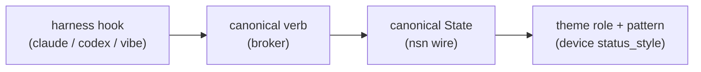

<!-- audience: user -->
# Notifier status language

The Notifier ring speaks a status language: every coding-session status maps to a
distinct color role within the active theme plus an animation pattern, so a glance
tells you what is happening and on which session without reading the screen. Use this
page to trace a status from the harness hook to the LEDs. The status table in section 2
is checked against the firmware in CI (`tools/check_status_doc.py`), so it reflects
what the current build does.

The chain has four hops:

## 1. Harness hook → verb → State

Each harness adapter normalizes its hook events to a **canonical verb**; the broker
maps that verb to a **State** (`notify/broker/session.py` `_VERB_TO_STATE`). Unknown
verbs default to `Running`.

| Harness | Hook / event | verb | State |
|---|---|---|---|
| Claude | SessionStart | `start` | Idle |
| Claude | UserPromptSubmit / PreToolUse | `running` | Running |
| Claude | Notification `permission_prompt` | `notify:permission_prompt` | AwaitingApproval |
| Claude | Notification `elicitation_dialog` | `notify:elicitation_dialog` | WaitingInput |
| Claude | Notification `idle_prompt` (idle 60 s) | `notify:idle_prompt` | WaitingInput |
| Claude | Stop | `done` | Done |
| Claude | SessionEnd | `end` | Offline |
| Codex | SessionStart | `start` | Idle |
| Codex | UserPromptSubmit / PreToolUse | `running` | Running |
| Codex | PermissionRequest | `approval` | AwaitingApproval |
| Codex | Stop | `done` | Done |
| Codex | **Stop in _plan_ mode** | `plan_pending` | **WaitingInput** |
| Codex | SessionEnd | `end` | Offline |
| Vibe | pre_tool | `pre_tool` | Running |
| Vibe | post_tool success / failure / cancelled | `post_tool:success` / `:failure` / `:cancelled` | Running / Error / Running |
| Vibe | post_agent | `post_agent` | Done |
| Vibe | approval wait heuristic (no tool result within the timeout) | `hitl_inferred` | AwaitingApproval |

Vibe releases before 2.21 used `before_tool`, `after_tool:*` and `post_agent_turn`; the
broker still accepts those names and maps them the same way.

**Codex plan mode.** Codex hooks (as of v0.124.0) have no dedicated "plan question"
event: a plan-mode turn that stops to wait for you fires the same `Stop` hook as a
finished turn. The adapter (`notify/harness/codex.py`) reads `permission_mode` and
re-tags a plan-mode `Stop` as `plan_pending`, which maps to WaitingInput, so the ring
breathes instead of showing Done. Only `done` is reinterpreted; running, approval and
error keep their own meaning.

## 2. State → {theme role, pattern, brightness}

The device resolves each State to a **theme-family role index** + an **animation
pattern** in one place: `lib/core/src/status_style.cpp` (`statusStyle()`), host-tested
in `test/test_status_style`. Ring behavior is computed from `(State, active theme)`,
not from the raw wire hue, so changing the theme recolors the ring.

**Ambient rule.** The ring is all-day peripheral signage, so nothing that persists may
strobe. Every needs-you state is the same smooth ~2.6 s breathe and hue alone carries
the meaning: cool means answer, amber means approve, and the theme's reserved alert red
means error. Red stays unmissable because nothing else is ever red. Fast motion is
allowed only as sub-second one-shot transition cues, and even those swell or slide
rather than flash. `Anim::Blink` maps to no status (a host test asserts this; the enum
remains for wire compatibility).

| State | Role (palette index) | Pattern | Bright | Meaning |
|---|---|---|---|---|
| Running | 0 - primary | **Comet** (sweeping tail) | 100% | model / tool working |
| WaitingInput | 1 - accent | **Breathe** (~2.6 s) | 100% | needs you (answer) |
| AwaitingApproval | 3 - detail (amber) | **Breathe** (~2.6 s) | 100% | decision / permission gate |
| Done | 2 - success | **Fade** (settle → 38% ember) | 85% | turn completed |
| Error | - alert hue | **Breathe** (~2.6 s, "breathing red") | 100% | tool / turn errored |
| Idle | 0 - primary | Static dim | 20% | session open, no active turn |
| Offline | - | Off | 0% | session ended (segment freed) |

One-shot transition cues (soft by rule): born = the arc grows fading in from dim in its
own hue (350 ms); dying = collapse fading out (350 ms); Done = one green sweep (500 ms);
web-action confirm = a soft pulse window (no Flash). In **Dark** battery mode the
single-LED cue keeps this table's hue, so an Error still breathes red there.

`Role` is an index into the active theme's color family; `alert` uses the theme's
dedicated alert hue (below), so Error reads as danger while staying in-family.

## 3. Theme families

Themes are multi-hue **families**, not single colors (`lib/core/src/theme.cpp`,
`themePalette()`; served to the web UI at `GET /api/themes`). Role indices above pick a
color _within_ the active family, so the whole ring wears one coherent palette while
each status stays distinguishable by role + pattern.

Themes: `teal, ocean, ember, forest, openai, anthropic, mistral, rainbow, gemini, perplexity`.

**Alert hue per theme** (`themeAlertHue()`): each theme reserves a warm alert hue so
Error reads as danger without a pure-red clash on cool palettes.

| Theme | Alert hue | | Theme | Alert hue |
|---|---|---|---|---|
| teal | 10 (coral) | | anthropic | 4 |
| ocean | 14 (warm amber) | | mistral | 2 |
| ember | 2 (red) | | rainbow | 0 (red) |
| forest | 6 | | gemini | 6 |
| openai | 4 | | perplexity | 12 (amber) |

## 4. Wire: nsn v2 carries harness + title

The nsn frame is **v2**: each segment carries the legacy `{state, hue, anim, progress}`
plus an optional **harness tag** (claude/codex/vibe) and a short **title** (session
task / cwd basename), appended as a backward-compatible TLV under the same magic - a v1
decoder ignores the trailing bytes (still CRC-covered). This is what lets the
SessionDetail screen show "**codex · deploy-plan · waiting**" instead of a meaningless "job 3".
Codec: `lib/core/src/nsn_proto.cpp` (byte-locked to `notify/broker/frame.py` in [nimbus-notify](https://github.com/ristllin/nimbus-notify)
via generated vectors). See [`hardware.md`](hardware.md) for the Bluetooth transport.

The broker caps the v2 payload at the wire's 1-byte length field (≤255 bytes): with many
long-titled sessions it budgets titles greedily and degrades a segment to harness-only rather
than overflow (the device encoder guards the same limit). **Known limitation:** the broker
sets a harness tag for every real session, so any frame with at least one active session is
v2 (`LEN > 68`). A device still on pre-v2 firmware rejects such frames because there is no
protocol-version negotiation. The fix is to update that device's firmware.

## 5. One session fills the ring

A lone active session fills all 45 LEDs. Status is carried by color and pattern (red
means error, nothing else), never by arc length, so a single errored session shows as a
whole red ring rather than an arc with a gap. Stale segments age out on a timer scaled
to the battery mode, so a finished or errored job cannot leave red pinned over a healthy
set.
