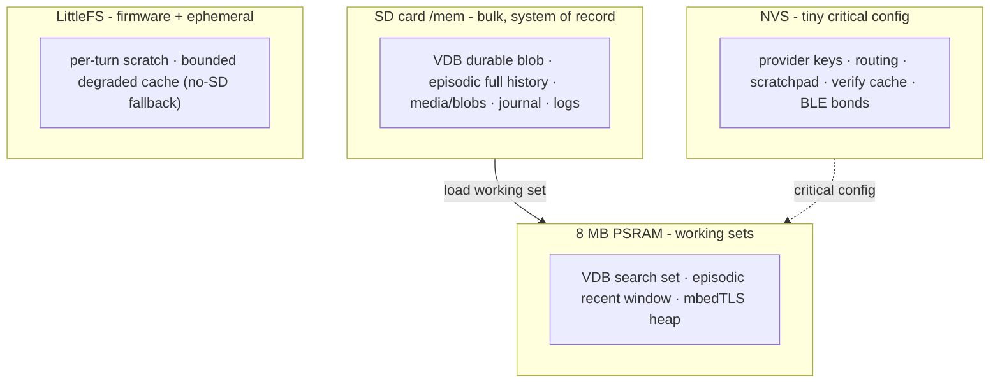

# Nimbus Tiered Storage Architecture (SD-primary)

Canonical record of **what data lives where** in the Orchestrator "World" memory
system, and why. Companion to [`orchestrator-world.md`](orchestrator-world.md)
(the cognitive tiers) and the
[orchestrator live turn](architecture/orchestrator-live-turn.md) (the live turn). Read this before touching `memory_subsystem`, `vector_memory`,
`episodic`, or the SD mount.

## 0. The design rule

All bulk data (vectors, episodic history, media blobs, logs) lives on the SD card. Internal flash and RAM hold only small critical config and a bounded degraded cache. Two hardware constraints shape the rest: working sets belong in the 8 MB PSRAM, not the ~300 KB internal SRAM, and the device must keep working, with bounded storage, when no card is present.



The pre-redesign code violated this rule in three locatable ways:

1. **VDB working set in internal SRAM.** `g_vec` holds `std::vector<VecEntry>` on
   the default heap. At `maxVectors=2000` (256-dim int8) that is ~1.14 MB -
   guaranteed OOM on a device with tens of KB free internal heap.
2. **Episodic is a 500-message RAM ring** whose *whole* blob is rewritten on every
   `captureMessage` - O(history) write amplification and a hard 500-message
   ceiling, the opposite of "all history on SD."
3. **Persistence defaults to LittleFS** and only routes to SD if `setDataFs(SD)`
   runs. With no card, vectors grow **unbounded on the ~few-MB LittleFS partition
   with no overflow guard** - the one genuinely dangerous path (flash exhaustion).

## 1. The four tiers

Rule of thumb:
- **NVS** - tiny critical config that must survive an over-the-air firmware update and is
  human-set (model-read-only). Card-independent.
- **LittleFS (internal flash)** - firmware + ephemeral per-turn scratch + a
  *bounded* degraded fallback cache when there is no SD.
- **PSRAM-working (8 MB)** - in-RAM working sets and indices (volatile,
  rebuildable from SD/flash): the VDB search set, the episodic recent window.
- **SD (durable)** - the system-of-record for everything bulk.

| Data type | Tier | Format / path | No-SD fallback |
|---|---|---|---|
| VDB vectors - working set | **PSRAM** | `entries_` in PSRAM heap | reduced-cap set still in PSRAM (or internal if no PSRAM) |
| VDB vectors - durable | **SD** | `/mem/vectors.bin` (existing `serialize` blob) | `/data/orchvec.bin` on LittleFS, **hard-capped** (≈400 vecs) + eviction |
| Pending memory writes (embedding outage) | **SD** | `/mem/pending_embed.bin` (at most 64 facts or 48 KB; text only) | `/data/pendemb.bin` on LittleFS, behind the same free-space floor as the vectors |
| Episodic - full history | **SD** | `/mem/episodic/YYYY-MM-DD.jsonl` append-log + `index.bin` | in-RAM 500-ring + `/data/episodic.bin` whole-blob (as before) |
| Episodic - recent window | **PSRAM** | recent-N ring, hydrated from SD at boot | the ring *is* the whole history |
| Media / voice / artifacts | **SD** | `/mem/blobs/<hash>.<ext>` content-addressed | ephemeral only (`/voice.pcm`, `/reply.mp3`, `/audio/tgvoice.ogg`), deleted per-turn - **no durable media** |
| Telegram archive (every message and file in or out, full size) | **SD** | `/mem/tg/<chat>/<day>/` raw JSON, media and `index.jsonl` ([memory.md, section 4](memory.md#4-the-telegram-archive-sd-card)) | not kept (SD only) |
| Scratchpad (goal tiers) | **LittleFS** | `/data/scratchpad.bin` (~4 KB; the `orchmem` NVS copy until v4.5.14) | unchanged |
| Usage ledger (spend and budgets) | **LittleFS** | `/data/usage_ledger.txt` (the `usgLedger` NVS key until v4.5.14) | unchanged |
| Journal | NVS (6 slots `agjournal/j0..j5`) - the SD day-stream was PLANNED, never built | - | same NVS |
| Provider keys / routing / config | **NVS** | `solide::memory` keys | unchanged |
| Verify cache | **NVS** | `vfy_*` | unchanged |
| Provider model catalogs (rebuildable cache) | **LittleFS** | `/data/mcat_<provider>.json` (see [the NVS budget](reference/config-and-nvs.md#nvs-budget-and-the-full-storage-contract)) | same LittleFS |
| Logs / diagnostics | Durable error log (`GET /api/errlog`) on SD `/log/nimbus.log` (rotated 4x256 KB), plus the 1280 B RAM ring (`GET /api/log`) + serial. Beside it in `/log`: the boot counter (`boot.n`) and the crash dedupe record (`crash.seen`). Device EVENTS are also durable via the episodic `system` timeline (kind=log); events captured before the clock syncs wait in `/mem/pending_ev.txt` | - | flash fallback `/log` on LittleFS (2x24 KB) + RAM ring; held events in `/data/pending_ev.txt` |

Two things **do not move**: NVS config/keys/verify are already at the
right tier and are card-independent - the "critical info" the design rule keeps off
SD. Rebuildable caches never live in NVS: the 20 KB partition is reserved for owner
config and bounded values (the full rule and the HTTP 507 contract for a save that
does not land are in the [Config and NVS reference](reference/config-and-nvs.md#nvs-budget-and-the-full-storage-contract)). Everything bulk targets SD with a **bounded** LittleFS/RAM degraded mode.

### Durable log: what persists, and its best-effort limit

The durable error log does not persist every line. Persistence is scoped by
severity: warnings, errors, and tagged key events (memory, provider, relay, OTA,
panel, NVS, storage, network, boot) are written to the log; routine info-level
lines stay in the RAM ring and serial only. This bounds internal-flash write wear
over the device's lifetime rather than writing every diagnostic line to flash.

A durable write is **best-effort**. Each log call takes the shared card lock with a
short timed try-acquire; if a large memory persist is holding the card, the write is
skipped so the log call never stalls the watchdog-guarded loop. A contention skip is
never a silent loss: the RAM ring and serial still hold the line, a dropped-line count
is recorded into the durable log itself at the next successful write, and the running
totals (`X-Log-Durable-Skipped`, `X-Log-Durable-Bytes`) are returned as headers on
`GET /api/log`, in `GET /api/errlog?list=1`, and on the device health row. If you need
every line during a heavy-churn incident, read the RAM ring (`GET /api/log`)
continuously rather than relying on the durable log alone.

**No line is lost before storage mounts.** The first lines of a boot (the boot record,
the HAL and network lines, an `[sd] mount FAILED` diagnosis) are emitted about a second
before any filesystem is mounted. They wait in a bounded early backlog (24 lines or
4 KB) and are written, in order, when storage attaches: the SD card right after its
mount (in both modes), or LittleFS right after `memory::begin()` mounts it when there is
no card. If the backlog overflowed, one marker line gives the exact count. A unit with
nowhere to write (Notifier mode with no card) frees the backlog at the end of start-up.
The card lock exists from the top of `setup()` in both modes, so the early attach never
opens a second writer on the card. A tier change is logged only when it really happens
mid-run (`SD lost: ...` / `SD available: ...`), never on a normal boot.

**One open file.** The active log file is held open; each line is one write plus a
flush (an fsync, so a line written right before a crash is on the card). The file is
reopened only on rotation, a tier change, a remount or a write error. If it cannot be
opened, the log degrades to the RAM ring and retries at most every 10 seconds, and the
first line after recovery is followed by a marker with the number of lines missed.
(Opening a file per line made every log line an internal-RAM allocation that aborts on
failure, so the log could turn a low-memory moment into a crash.) The handle is closed
before anything unmounts or reformats the card, and during a factory erase.

**The forensic window.** Routine copies of the per-request relay lines, the per-exchange
`transport: heaptrace` line and the per-round `headloop` line stay in the RAM ring and
on serial. The durable log keeps the abnormal ones (no response, a 5xx, a capped round,
internal memory under 12 KB free or an 8 KB largest block) and one folded relay summary
every 15 minutes. These lines once filled 83-98% of every rotated SD file, so whatever
led up to a crash aged out within hours.

### Boot record and crash report

The first durable line of every boot is its boot record:

```
boot: n=17 fw=v4.5.14 build=v4.5.14-3-gabc1234 reason=usb(0x15) wake=none mode=orch t=0 prev=none
```

`n` is the boot number (kept in `/log/boot.n`, stamped into the line when storage
attaches; serial shows `n=?`). `reason` names every ESP-IDF reset reason with the
chip's raw reset code beside it (one table in `nimbus/sys/reset_reason.h`; `unknown`
only for value 0 or an out-of-range value, always with the number). `t` is the wall
clock the chip kept across the reset (software, panic and watchdog resets keep it),
else 0. `prev` is where the previous run stopped, from a 48-byte record in RTC memory
that every boot stage, turn start and turn round updates (and the main loop every
5 seconds): for example `prev=n16/367161s/turn-r2/h1180` (boot 16, 367161 s up, round 2
of a turn, lowest internal free heap 1180 B), or `prev=1s/storage` for a boot that
passed the SD mount and died in the memory load. It survives software, panic, watchdog
and USB resets and deep sleep, so it explains a brownout-like or early-boot death that
leaves no core dump; a power cycle clears it (`prev=none`).

Every panic and watchdog reset writes a core dump to the 64 KB `coredump` flash
partition. The next boot reads it once, right after storage attaches, and writes:

```
crash: fp=1a2b3c4d new=1 this-reset=1 task=tg_poll pc=0x4201abcd cause=28(LoadProhibited) vaddr=0x00000000 size=23456/65536 elf=0badf00d1 fw-match=1
crash-bt: depth=12 corrupt=0 0x4201abcd,0x4201b0c4,...
crash-why: Stack canary watchpoint triggered (tg_poll)
```

- `fp` is the dump's own stored checksum, so the same dump reads the same fingerprint
  on every boot. `/log/crash.seen` records the last one reported: a dump already
  reported is mentioned once per boot as a single `crash:` line with `new=0`.
- `this-reset=1` when this boot's reset was the crash; `fw-match=0` after an update,
  because the dump belongs to the previous release (decode it with that release's ELF).
- `crash-why` is the panic message the dump recorded. ESP-IDF records one only for
  `abort()` (the stack-overflow check aborts too) and the task watchdog. A CPU exception,
  the end-of-stack watchpoint and the interrupt watchdog record none, so the reason is
  then built from the exception cause, for example
  `crash-why: StoreProhibited in loopTask: a write to an invalid address (0x00000000); no panic message in the dump`.
  Every crash states a reason.
- The report never contains stack bytes or the exception registers: a stack in transit
  can hold a provider key or the bot token.
- The dump is never erased by the reader, so a bench can still pull it over USB; the
  next crash overwrites it, and a factory reset erases it.
- The same summary is in `GET /api/state` (`boot.crash`, `null` when there is no dump)
  and on the episodic `ev:boot` row, so the assistant can say why it restarted.
- After a crash boot the owner gets one plain-words Telegram message that says what went
  wrong (a software error, part of it stopped responding, it ran out of memory, or one
  of its jobs ran out of memory) and names the request that was cut short
  (`/crash/turn.json` on LittleFS, written at turn start and cleared when the turn ends;
  the round reached rides the RTC record above). The file is skipped
  when internal memory is below the forensic floors, because a file open is itself an
  allocation that aborts on failure; the RTC record still names the request then.
- When: at once when the crash cut an owner request (a message, photo, voice message,
  file or console request - the owner is waiting on that reply). A crash that cut a
  background turn (a routine, such as the nightly memory pass) is held and sent once,
  at the owner's next turn; a crash with nothing in progress still goes out at boot.
  Never more than one notice per boot (`nimbus/orch/restart_notice.h`).

Device events captured before the clock syncs (a power-on boot has no time until SNTP
answers) wait in a 16-row / 4 KB file on the data store instead of RAM, so an offline
boot or an early crash loop no longer loses its boot row: the first sync on any later
boot writes them, labelled with the boot that captured them.

## 2. VDB - working set in PSRAM, durable on SD

The engine is **in-house**, not a ported vector database: `VectorMemory`
(`lib/core`) is a flat (brute-force) cosine store over **int8-quantized** vectors at
a **set-once dimensionality** (256 by default; the embed gate may lock a
provider-native width). "Flat" means every recall scans every candidate - fine for
the low thousands of small vectors a desk device holds, and it needs no index to
keep in sync. Recall is `relevance x recency x importance` with query-time TTL
filtering, near-duplicate collapse, and MMR-on-ties. The whole store is browsable and
capped; there is no ANN library and no on-device embedder (vectors arrive already
embedded through the provider `/embeddings` seam).

`VectorMemory` is portable/Arduino-free and allocator-agnostic, so its allocations
are routed **from the device seam**, not by editing the portable class.

- **Working set → PSRAM.** Place the engine and its hot storage in PSRAM via
  `heap_caps_malloc(MALLOC_CAP_SPIRAM)` (the pattern the PSRAM-mbedTLS allocator
  already proves - see the `nimbus-psram-tls` note). Gate on
  `esp_psram_is_initialized()` at boot; if PSRAM is absent, fall back to the
  reduced-cap internal path (§4). Capacity: 256-dim int8 ≈ 570 B/vector in RAM ⇒
  **~6000 vectors fit** in the PSRAM budget after TLS/JSON headroom (device cap
  set well below `kMaxVectorsMax`). Dims stay locked by the set-once embed gate.
- **Durable → SD.** Keep the byte-clean `serialize`/`deserialize` blob; change
  only the path (`/mem/vectors.bin`) and the **write discipline**: a **dirty flag**
  set by mutating ops only (not read-only recalls), debounced, written
  `.tmp`→rename for crash-atomicity. This kills the "rewrite the whole blob after
  every tools/call" amplification.
- **Migration** is already half-built: `loadBlob` reads SD-first, LittleFS-
  fallback, so the first SD-backed persist carries existing LittleFS memories onto
  the card.

### 2a. Archive - the TTL-expired cold store

Re-embedding text is the expensive operation the device most wants to avoid, so a
memory that reaches its time-to-live is **not deleted - it is moved to an archive**,
embedding and all, where it can be searched or restored later without paying to embed
it again. **This exists only on the SD card.** With no card the live engine drops
entries at TTL exactly as before; an archive is a bonus of having storage, never
something the card-less device pays for.

- **Same engine, separate store.** `VectorArchive` (`lib/core`) is the same in-house
  int8 flat-cosine PSRAM store as the live VDB, persisted to its own SD blob
  `/mem/archive.bin` (byte-clean `serialize`/`deserialize`, `.tmp`→rename, written
  only when a **dirty flag** says it changed). It is a distinct engine, not a flag on
  `VectorMemory`, so archived entries are **invisible to normal recall by
  construction** - they are simply not in the live set.
- **Expiry moves, not deletes.** `VectorMemory::pruneExpired` takes an optional
  archive **sink**. The device attaches it **only when a card is present**, so the
  nightly maintenance pass that used to delete an expired entry now moves it into the
  archive instead. On SD loss mid-run the sink detaches (back to drop-at-TTL); on
  recovery it re-attaches.
- **Capped, FIFO.** The archive is bounded (default 2000 entries); when full the
  **oldest-archived** entry is evicted first. Pinned/creator memories never expire, so
  nothing pinned is ever in the archive.
- **Tools, gated on the card.** `memory.archive` (`search` | `restore` | `list`) is
  registered **only when the archive is bound** (i.e. a card was present at boot), and
  every action re-checks the card is still there (a mid-run pull refuses cleanly).
  `restore` brings an entry back into the live store, **quota-respecting**: it resets
  the TTL clock, lifts importance above the prune floor, honors `max_vectors` and the
  pin budget, and - if the live store is at its cap - refuses without losing the
  archived entry. All of it stays inside the caller's **namespace boundary**: a member
  only searches or restores its own archived memories.

## 3. Episodic - SD append-log + index, PSRAM recent window

**Decision: append-only JSONL day-streams + a compact binary offset index - not a
SQLite dependency.** Append is O(1) (seek-end, write one line); the index makes
date/session/kind queries cheap; a truncated last line is tolerable (same
philosophy as the tolerant vector deserialize); and it matches the documented
design intent (an append-only JSONL day-stream). SQLite stays deferrable behind
the same `EpisodicStore` interface. This
resolves the long-standing **F10 "SQLite-on-SD unbuilt"** item without the lib.

```
/mem/episodic/
  2026-07-04.jsonl   # append-only, one EpisodicMessage per line
  index.bin          # (tsHours, sessionId-hash, kind, day, byteOffset) fixed-width
  sessions.jsonl     # append-only EpisodicSession rows
```

- **Append path:** `captureMessage` writes one JSON line to today's file + one
  fixed-width index record. No whole-file rewrite → the 500-cap that protected the
  rewrite is lifted.
- **Recent window (PSRAM):** an `InMemoryEpisodicStore` recent-N ring, hydrated at
  boot by tailing the newest day-streams; serves context assembly + `memory.*`
  reads without SD I/O. It stops being the system-of-record and becomes a cache.
- **Query path:** the existing `MsgQuery` (session/kind/time-window/textContains/
  limit) is served index-first (skip day-files outside the window; reject on
  session/kind before opening the JSONL; textContains scores the survivors by the
  shared word rule, see "Text search" in §3a). A window fully inside the recent ring
  answers from RAM with zero SD I/O.
  Same semantics the in-memory store is host-tested against ⇒ tests transfer.

### 3a. Deep history - the boot index, the backfill, and the cold query

The boot scan is deliberately **budget-bounded** (`kHydrateMaxRows` 4000 /
`kHydrateMaxBytes` 256 KB): an unbounded scan of a busy month's history took long
enough to trip the boot watchdog, leaving a device that could no longer start. The
byte budget is the one that binds - real rows average about 600 B on the card
(trace rows run near 1 KB), so the boot scan indexes roughly 400 rows. Two rules
keep that partial index honest:

- **The boot index is a contiguous suffix of history.** The scan walks the newest
  day first and stops after the first file it could read only in part, or when
  less than `kHydrateMinTail` (4 KB) of the budget is left. It never indexes an
  isolated older row below a hole, so the index floor, the cold cursor and "newest
  first" ordering all describe the rows the index really holds.
- **The index converges to the whole card after boot.** `backfillStep()` indexes
  what the boot scan left out, newest region first, one backward window at a time
  (8 KB and at most 32 rows per slice; a window grows only for a single long
  record, up to 128 KB). The main loop drives it (`memory::episodicBackfillTick`):
  at most one slice per 250 ms, only while no turn is in flight, only when the TLS
  work slot is free (`acquireWork(0)`), and only if the card lock is free within
  20 ms. No task of its own, no TLS, no NVS and no new on-card format: the index
  is still rebuilt from the day-streams on every boot. The SD log records
  `memory: episodic index complete (N rows, M added in K slices, ...)` when it is
  done. The index is capped at `kIndexMaxRows` (20,000 rows, about 2 MB of PSRAM);
  past the cap, or with a record too long to read whole, the index stays marked
  incomplete and says so. A file that keeps failing to read pauses the backfill,
  which retries every 5 minutes from where it stopped; the index stays marked
  incomplete meanwhile.

`indexComplete()` is the store's honest answer to "does the index hold every row on
the card". It is false while the backfill runs (or after it stopped short), and
everything that consumes the index reads it: retention defers the blob sweep (§4),
the `memory.episodic` count says "older history on the card is not in this count",
`GET /api/mem/episodic` returns `indexComplete`, and `/api/state` returns
`epiIndexComplete`.

While the index is incomplete, the older rows are on the card but not in the index,
and the cold query reaches them:

- **Text search** (`nimbus/orch/lexical.h`) - the `text` filter splits the
  query into words (whitespace and punctuation), drops common words ("the", "my",
  "what", ...) and one-letter words, trims one plural or verb suffix ("boats" ->
  "boat"), and matches case-insensitively by substring (a word under 4 bytes must
  start a word, so "ai" never matches "said"). A row matches when **any** counted word
  occurs. With two or more counted words the page is **ranked**: rows holding more of
  the different words come first (ties: newest first), the store examines every row
  in the call's window (the RAM ring, the read-budgeted index, or the cold budget)
  and keeps the best `limit` (capped at 200), and `EpiQueryInfo::matched` reports how
  many rows matched so a short page is never presented as everything. The scan stops
  early once the page is full of rows holding **every** word (nothing can beat them),
  so paging with the cursor never skips a full match; a partial match that ranked
  below the cut in its window is counted but not returned. One counted
  word keeps the old contract exactly: newest-first, stop at `limit`, page with no row
  lost. A query of only common words matches nothing and reads nothing. The old rule
  required **every** word, so a three-word query found nothing when the stored row
  held only one of them. Memory:
  the parsed query is ~220 bytes on the caller's stack, a ranked page adds one score
  byte per kept row (at most 200 bytes of heap), and matching scans each row in place
  with no per-row allocation (the old matcher lowercased a full copy of every row).
- **Cold query** (`MsgQuery::coldScan`, opt-in) - when the indexed range comes up
  short, walk the day-streams *below each file's own index floor*, newest record
  first, reading backward in bounded windows. The unindexed region is **per file**:
  the boot scan reads each day-stream's tail, so the newest file can hold thousands
  of rows above the global floor day. Two budgets keep a single call safe on the
  querying task - at most a few files and ~128 KB per call - and the pass **pages**:
  it reports the exact cursor to resume from.
- **Cursor** (`MsgQuery::before`) - a row id for the indexed range, a
  `"<day>:<offset>"` byte cursor for the cold range. The store emits the next token;
  no caller (and no model) computes one. The indexed range is itself budgeted, so
  even a query that never leaves the index pages: rows still in the RAM ring are
  matched from memory, older rows come off the card in blocks (one read covers a run
  of neighbouring rows of one day-stream that the in-RAM filters keep, up to the
  8 KB window; a lone match reads only itself), at most 120 reads and 128 KB per
  call.
- **Honest floor** (`EpiQueryInfo`) - every answer carries how far back it looked,
  whether older history remains, and the resume token. A call that stopped early
  (budget or a full page) reports the day it reached, not the index floor.
  "No results" from a bounded read is reported as exactly that, never as "it never
  happened".

Surfaces: `memory.episodic` cold-scans by default and takes `before`; its result
ends with a "searched back to `<date>`; older history exists … `before=<token>`"
line when there is more. `GET /api/mem/episodic` gains `cold` / `before` params and
returns `searchedTo` / `olderExists` / `nextBefore` (and `matched`, the rows the `text`
filter matched in the range searched) and `indexComplete`; `GET /api/mem/stats`
exposes `epiTruncated` + `epiFloor`, plus `epiIndexComplete`, `epiBootIndexed` (rows
the boot scan indexed) and `epiBackfillRows` (rows indexed after boot). The `[HOW YOU RUN]` prompt tells the model the log
reaches months back and to search it before claiming not to remember. Hot per-turn
windows never set `coldScan`, so they stay zero-read.

⚠ **The window is a heap allocation on the querying task.** The web task holds
~8 KB of stack next to ~60 KB of free internal SRAM, so the window size is a
crash boundary, not a performance knob - an early 128 KB window took the device
off the LAN mid-query. Kept small (8 KB, escalating only for an over-long record);
the budget is what bounds the work, not a big buffer.

## 4. Media / blobs - SD `/mem/blobs`, referenced by episodic `blobPath`

Content-addressed sidecars: on capture (Telegram voice note, mic record, inbound
image/doc), hash the bytes → `/mem/blobs/<hash>.<ext>`, then
`captureMessage(kind=Audio/Image/File, blobPath=…)`. The episodic row is the index;
the file is the payload; identical bytes dedup for free. Ephemeral in-flight files
(`/voice.pcm`, `/reply.mp3`, `/audio/tgvoice.ogg`) stay transient LittleFS scratch
(privacy-deleted per turn); the **durable copy** is the SD sidecar (erase the card
to purge).

**Retention.** Every ~6 h the main loop runs `memory::pruneRetention(30)`
(`nimbus/orch/retention.h` holds the portable rules, host-tested):

- **Day-streams** older than 30 days are removed. They are chosen by **file name**,
  not from the index, so a day the index never saw still ages out.
- **Blob sidecars** no row references are removed by a reference-count sweep, but
  **only when the index is complete**. With rows on the card that the index has not
  reached yet, "referenced by no indexed row" would include blobs those rows still
  point at (this deleted a field device's attachments after a restart). The sweep
  is then skipped, the report says `blobGcSkipped`, and the log reads
  `blob GC deferred: index incomplete`; a later pass sweeps once the backfill is done.
- **Never during a turn, never waiting on the card lock.** While
  `orchestrator::turnInFlight()`, or when the card lock stays busy for 50 ms (a web
  query or a memory tool holds it), the pass touches nothing and is deferred; it
  stays due and runs on the first loop pass after that ends (`RetentionSchedule`),
  logged once as `retention deferred`.
- **The Telegram archive is exempt.** Nothing under `/mem/tg/` is ever deleted by
  retention (`isRetentionExempt`, the one predicate every retention delete passes).
- **Internal heap.** Every container the pass builds (the day list, the reference
  set, the orphan list, the report) uses the PSRAM working allocator, and
  directories are read with `readdir` (no file opened per entry), so a pass over
  thousands of rows or blobs does not hold hundreds of small internal-heap blocks.

Test builds can ask for a pass out of schedule with `POST /api/test/epiprune`; it
goes through the same schedule and gate.

## 5. Migration and no-SD degraded mode

**Boot/mount:** `solide::storage::begin()` → on success `setDataFs(SD)`,
`g_haveSd=true`. LittleFS always mounts (config + migration source + degraded
store). `esp_psram_is_initialized()` decides PSRAM vs reduced-cap internal.

**Migration** (one-time, on first successful SD mount): vectors migrate via the
existing SD-first/LittleFS-fallback `loadBlob`; episodic replays the old
`/data/episodic.bin` blob into day-stream appends, then drops a `.migrated` marker
(no double-migrate).

**Degraded mode** (`g_haveSd==false`) - the system still works, **bounded**:

| Subsystem | Degraded behavior |
|---|---|
| VDB | working set in PSRAM (or internal); durable to LittleFS **hard-capped ≈400 vecs** + score eviction. Closes the unbounded-flash bug. |
| Episodic | no-card-AT-BOOT: in-RAM 500-ring + LittleFS whole-blob. ⚠ a MID-RUN demote keeps the append-log (256-ring, nothing persists until promote) (as before). |
| Media | **refused**, not degraded (since v3.7.0): an inbound photo or document is declined with a message suggesting the sender describe it in words. Media on internal flash would compete with the firmware's own OTA slots for a 3.5 MB partition, and one phone photo can be a sixth of it. Voice notes still transcribe (the audio is transient); only the durable copy is skipped. |
| Files (artifact store) | **unavailable**: `artifact.save` fails with a legible reason and the listing reports `present:false`. |
| Tenants (roles + quotas) | fully functional - the table lives on **internal flash**, not the card, so losing a card never drops everyone's role. |
| Privacy boundaries | fully enforced - namespace and session filters live in the portable query layer, not the SD path, so degraded mode cannot open up what full mode keeps apart (asserted by `tests/hil/test_l20_degradation.py`). |
| Journal / logs | last-N RAM ring + small rotating LittleFS file. |
| Config / keys / verify | fully functional (NVS). |
| Scratchpad, usage ledger | fully functional (LittleFS `/data`, card-independent). |

**Verification signal (per AGENTS.md's bar):** a no-card boot logs
`memory: storage tier=flash /data (no SD) sd_mounted=0 ...`, the dashboard shows the
banner "No SD card - memory is limited to N entries on internal storage, with no
durable media or history. Insert a FAT32 SD card for full storage.", the `STATUS`
console line reports `sd=absent` (and `/api/mem/stats` reports `sdPresent:false`),
and a `RENDER?`-assertable indicator lets HIL *prove* the degraded path. SD is
re-probed live (`/api/sdprobe` / timer / menu) so inserting a card upgrades the
tier + runs migration without a restart.

⚠ **The boot scan is BOUNDED, and must stay that way (F31).** `hydrate()` runs
inside `setup()`, before the device can serve anything, on a path the watchdog
watches. It used to read every day-stream whole and parse every row; a device
that had merely accumulated ~15 K rows could no longer start, and no amount of
power-cycling helped - retention prune runs *after* boot, so it could not
recover the device either. The scan now walks the newest day first and stops at
a row budget, a total-byte budget, and a per-FILE window read as the file's tail
(a single oversized file defeats a per-scan-only budget). Older rows stay on the
card and remain reachable by a dated query; they are simply not indexed at boot,
which `hydrateTruncated()` reports, and the backfill (§3a) indexes them after boot
from the main loop. **Any future work here keeps that property: a device must be
able to start regardless of how much it has written.**

**LittleFS overflow guard:** the degraded VDB persist checks free space
(`totalBytes-usedBytes`) before each write; below a floor it stops accepting new vectors
and logs `memory: vectors flash full (free=..KB need=..KB) - persist paused`.
`memory::flashFull()` and `/api/mem/stats` report the paused state.

## 5b. Implementation status

**In place** (host-tested; confirmed on device via `/api/log` and `/api/mem/stats`):
- PSRAM working set (§2): `psram_alloc` seam + device hook install; on-device
  `[psram] VDB working set -> PSRAM`, internal heap **148 KB free** (was ~45 KB).
- SD-primary paths (`/mem/*`) + LittleFS `/data` degraded fallback + SD-first/LittleFS
  migration read; atomic `.tmp`→rename writes.
- Degraded cap (400) + LittleFS overflow guard; dirty-flag persist (mutating tools only).
- Tier status: `memory::haveSd()/flashFull()`, `/api/mem/stats` fields + dashboard
  degraded banner, `STATUS sd=/psram=/minheap=/vec=`, live `/api/sdprobe` re-mount.
- Blob content-addressing utility (§4); a width-invariant bug was found, fixed, and
  regression-tested.

**In place, verified with a mounted card:**
- Episodic **append-log day-streams + offset index** (§3): `AppendLogEpisodicStore`
  (`lib/core/.../episodic_log.h` + `orch_episodic_log.cpp`) behind the `EpisodicStore`
  interface - JSONL day-streams (`/mem/episodic/YYYY-MM-DD.jsonl`), an in-RAM offset
  index rebuilt at boot from the streams (one system-of-record; no separate index.bin
  to desync under power loss), a PSRAM recent-window fast path, and **uncapped history**
  (the 500-ring cap is lifted on SD). O(1) appends, index-first queries that never open
  an out-of-window day file, tolerant torn-line decode. Host-tested (`test_orch_episodic_log`,
  12 cases: O(1)-append proof via a write-counting fake FS, ring+index query parity vs the
  in-memory store, out-of-window skip, zero-read fast path, >500 history, hydrate/migration,
  torn-line tolerance, id-counter resume, retention prune, civil-date).
- **30-day retention prune** (§4): `AppendLogEpisodicStore::prune` drops old day-streams
  by name and, on a complete index, reference-count-scans away unreferenced blob
  sidecars; wired to `memory::pruneRetention()` behind the turn gate.
- **Durable media sidecars, WIRED + ON-DEVICE VERIFIED** (§4): `memory::captureMediaFile`
  STREAMS a LittleFS file → content-addressed `/mem/blobs/<hash>.<ext>` in a 512 B buffer
  (a streaming `BlobHasher`, so the ~480 KB mic PCM never loads whole into RAM), dedup +
  `.part`→rename atomic, then an episodic `Audio` row referencing it. Wired at three
  capture sites: the **inbound Telegram voice note** (`/audio/tgvoice.ogg`, persisted
  *before* the LittleFS privacy-delete), an **inbound Telegram photo or document**,
  and the **on-device mic turn** (`/voice.pcm`). A spoken reply is recorded as a text
  row, not a media sidecar. With no card this is a no-op. The resulting row
  appears in `/api/mem/episodic` as `{"kind":"audio","blob":"/mem/blobs/<hash>.<ext>"}`.
  Privacy note: raw inbound voice-note audio is retained on the card by design; erase the
  card to purge it.
- **Retention tick**: `main.cpp` loop calls `pruneRetention(30)` every ~6 h through a
  `RetentionSchedule` (no-op without an SD append-log or before the clock advances past
  the window; a pass deferred by a turn runs when the turn ends), and
  `episodicBackfillTick()` on every pass.
- **Device seam**: `ArduinoEpiFs` (fs::FS backing for the portable `EpiFs`);
  `memory_subsystem::begin()` routes episodic through the append-log when `g_haveSd`,
  with one-time whole-blob→day-stream migration; the card-less path is byte-identical to
  before (append-log constructed only on SD). `esp32s3` + `test` builds link.

**On-device verification (2026-07-04, firmware `[env:test]` flashed, card mounted):**
- Boot with the new firmware: `[sd] mounted: 14911 MB`, `store=SD /mem, cap=2000`.
- **Migration proven:** boot log `memory: migrated 37 episodic rows -> SD append-log`
  (the legacy whole-blob's 37 rows replayed into the SD day-streams).
- **Query proven:** `GET /api/mem/episodic` returns all 37 rows, newest-first, content-
  identical - the append-log serves reads via `readRange` over the real card.
- **Persistence across a restart proven (F10 crux):** after a `REBOOT`, the second boot
  shows `[sd] mounted` + `memory: ready` with **NO "migrated" line** and `episodicMsgs=37`
  - `hydrate()` read the day-streams back (hydrate()>0 → migration skipped, no double-
  migrate), and a post-restart query still returns all 37 rows. Durability confirmed.

**Not built:** the journal stays in its six NVS slots; there is no SD day-stream for it (see the journal row in section 1).

## 5c. SD quota and supported-card truth

The artifact store must not be able to fill the card the bulk tiers also live on,
so it carries a quota, recomputed from the REAL card size at every mount:

- **Quota = card capacity - a 512 MB reserve** (`FileStore::quotaForCard`, pure +
  host-tested). The reserve is headroom the firmware, logs, media, and sound packs
  need. A 16 GB card gets a ~15.5 GB store quota; a 1 GB card gets 512 MB.
- **Cards below 1 GB are UNSUPPORTED** (`FileStore::sdCardSupported`): once the
  reserve is taken there is too little left to be a useful store, so the card
  mounts with a zero quota and an explicit `unsupported` state, and saves refuse
  legibly rather than the store silently offering a tiny space.
- **A flaky mount that reports `cardSizeMB()==0`** keeps the safe 512 MB default
  quota (never a zero quota from a transient read).

**The payload carries four distinct truths** so a client never reconciles two
payloads to tell the store quota from the raw card free space. `GET /api/files/list`:

```
present card:  {present:true, unsupported:false, count, bytes(=used),
                quota(=card-512MB), cardTotal, cardFree, freeBytes(=quota-used), files:[...]}
absent card:   {present:false, files:[]}
tiny card:     {present:false, unsupported:true, files:[]}
```

`/api/state.files` mirrors `present/unsupported/count/bytes/quota/cardFree`, and the
`files.list` tool returns `count/bytes/quota/cardFree/freeBytes` for the model.

## 6. Implementation phases (value × testability)

**Phase A - host-testable now, no hardware.** Append-log episodic store behind the
`EpisodicStore` interface (in-memory FS shim for tests; query parity with the
in-memory store); degraded VDB cap + LittleFS overflow guard; blob content-address
+ reference-count prune; dirty-flag/debounced persist. *All at 100% on `native`.*

**Phase B - device seams, no card required.** PSRAM routing for `g_vec` + episodic
recent window (boot PSRAM assert; `STATUS` reports the PSRAM size as
`psram=<bytes>`); `sd=absent` status field + degraded banner + live SD re-probe.
*Verifiable on a board with no card via `STATUS`/`RENDER?`.*

**Phase C - SD-dependent (gated on the card being detected).** `/mem/*` paths wired
through `setDataFs`; LittleFS→SD migration converter; durable media sidecars;
retention/archival maintenance.

## 7. E2E test plan

**Host (`pio test -e native`, kept at 100%)** - all portable logic:

- VDB: `serialize`↔`deserialize` bit-exact; truncated-blob tolerance; lowest-score
  eviction (permanent/creator exempt); top-k + threshold recall + access-boost;
  degraded cap when no SD; flash-overflow refusal.
- Episodic: append-log makes **O(1) appends** (write-counting fake FS, no whole-file
  rewrite); query parity with the in-memory store; index skips out-of-window days;
  recent-window fast path (zero FS reads); uncapped history (>500 queryable); id
  counter resumes past loaded history.
- Blobs: content-address dedup; reference-count prune.
- Migration: LittleFS blob → day-streams (+`.migrated`, no double-migrate);
  vectors SD-first/LittleFS-fallback.
- Tiering/config: scratchpad file round-trip (moved out of NVS in v4.5.14); mem-config clamps.

**On-device HIL (`tests/hil`, `--allow-hardware`, gated markers)** - device
behavior; SD rows stay skipped until `cardType != 0`:

- *Without a card (Phase B):* PSRAM backs the VDB (`heapMin` stays off the OOM
  floor as vectors grow); no-SD degraded banner + `sd=absent` + clamped cap;
  LittleFS-overflow pause; persist-across-restart in degraded mode.
- *Gated on the card (Phase C):* SD mount + `/mem/*` created; migration on first
  mount; episodic full history on SD (cap lifted); durable media sidecar (voice
  note persists + episodic `Audio` row references it); recall into the live turn
  (must run off the main loop, not the watchdog-killed console `TURN`);
  persist-across-restart from SD; SD hot-plug upgrade.

Collection stays clean with no device; state-mutating rows restore in `finally`;
manual media/hotplug rows fail LOUD if unconfirmed. A HIL row counts only when
green on hardware.
