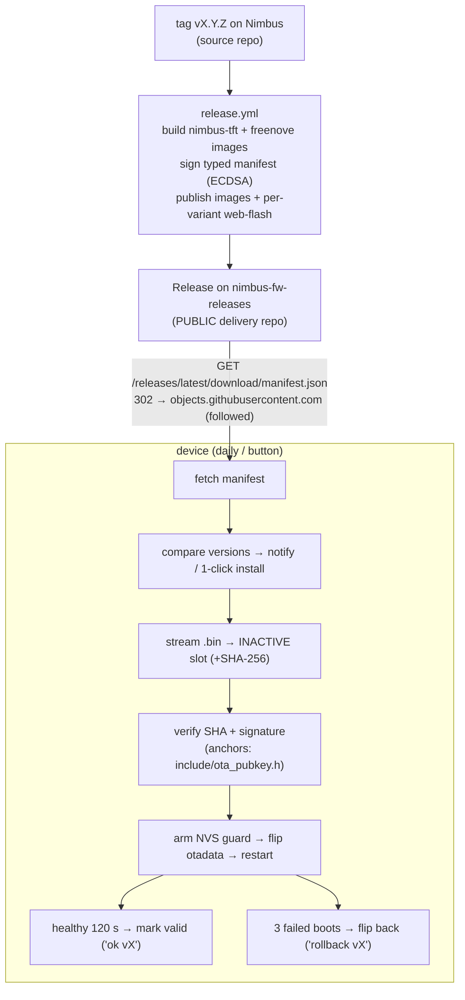

# OTA Firmware Updates

> This page describes how the device updates itself over the air, how a release is trusted, and what you see while an update runs. Read it before relying on OTA in the field or when an update check does not behave as expected. The release runbook (cutting a release, tokens, signing-key rotation) is maintainer-internal and not part of the public docs.

Nimbus updates itself over Wi-Fi from GitHub Releases. The flash layout is A/B
(stock `default_16MB.csv`: `otadata` plus two 6.5 MB app slots), so OTA needs no
partition change: the running slot downloads the new image into the inactive
slot, verifies it, flips the boot flag and restarts, and rolls back by itself if
the new firmware cannot boot.

⚠ **Delivery is from the dedicated releases repo [`ristllin/nimbus-fw-releases`](https://github.com/ristllin/nimbus-fw-releases), not the source repo.** The device
downloads over unauthenticated HTTPS with no repo credentials in the firmware,
so release assets live in a public, assets-only repo (the same pattern as the
SFX assets). The signed binaries carry no secrets; the ECDSA signature is what
devices trust. To ship firmware to your own fork's devices, see
[`self-hosted-ota.md`](self-hosted-ota.md).



## Trust model

- **Signature** (the real gate): CI signs, per variant, the canonical message
  `nimbus-ota-v2\n<version>\n<type>\n<sha256-hex>\n` with ECDSA P-256. The
  device rebuilds that message from what it downloaded and verifies it against
  the public keys in [`include/ota_pubkey.h`](../include/ota_pubkey.h) before
  the boot flag flips. Binding version and type rules out mixed variants and
  cross-version replay. `release.yml` publishes only the typed schema-2 manifest
  and `parseManifest()` rejects anything else, so the legacy `nimbus-ota-v1`
  message is no longer signed (see Typed manifests).
- **TLS**: downloads ride `tlsSetup()` (CA-bundle validation, `tlsVerify`
  default ON), so the transport is also authenticated on default settings.
- **Residual**: a MITM against a `tlsVerify=0` device can only replay an old
  *genuinely signed* release; auto-install moves strictly forward in version,
  so the worst case is pinning a device at its current version. Manual
  downgrade needs the authenticated web UI + `force`.
- The `test` variant additionally trusts a COMMITTED test key
  (`test/ota_test_key.pem`, `#ifdef NIMBUS_TEST` only) so the HIL suite can
  sign fixtures. Never flash `env:test` on a production unit.

## Typed manifests (v2)

The manifest is **typed**: `schema: 2`, and each entry in `variants` is keyed on
the device **type**, not the build tag. The four types are frozen:
`nimbus-tft` (the TFT + ring board), and `freenove-28` / `freenove-35` /
`freenove-40` (the all-in-one touchscreen, by panel size). A release publishes one
`manifest.json` holding every type that has an image; a device looks up only its
own type.

```
{ "schema": 2, "version": "v4.3.0", "notes": "...",
  "variants": {
    "nimbus-tft":  { "url": "...", "size": 3600000, "sha256": "...", "sig": "..." },
    "freenove-28": { "url": "...", "size": 3600000, "sha256": "...", "sig": "..." },
    "freenove-35": { ... }, "freenove-40": { ... } } }
```

- **Where the type comes from**: NVS key `otaType`, seeded by the flasher on a
  fresh install or written by the transition release on an existing device. If it
  is unset, the build falls back to its compile-time tag so dev/HIL builds
  (`test`/`test-cyd`) still resolve. A stored type from the wrong board family is
  refused (a Solide build only accepts `nimbus-tft`, a Freenove build only the
  `freenove-*` sizes), so a mis-seeded NVS can never pull a wrong-pinout image -
  the runtime twin of the compile-time board/variant bind in `ota_update.cpp`.
- **Untyped devices get no update**: a device whose type is empty (or absent from
  the manifest) matches no variant and reports "no update" - a settled state, not
  an error. **E-ink devices are frozen this way**: they carry no type, so after
  the transition release they never install again, and the final e-ink image reads
  "Updates have ended for this board."
- **The transition release** is a final **schema-1** manifest published under the
  tag existing firmware polls. Fielded firmware matches it by its build tag
  (`esp32s3`/`cyd`) and installs it; on first boot the new image derives its type
  from `scrModel` + board and persists `otaType`, then uses the schema-2 manifest
  thereafter. Generate it with `tools/make_manifest.py --schema 1`; the typed
  releases use the default `--schema 2`.
- **Derivation only guesses a single-type family.** A Solide + TFT board derives
  `nimbus-tft` (the Solide family has exactly one type). A Freenove has three sizes
  (`freenove-28` / `-35` / `-40`) that board identity cannot tell apart, so an
  unseeded Freenove derives no type and is offered no update: reflash it with its
  explicit size. The flasher seeds the exact size on every real install, so this
  only affects a Freenove that reached the typed scheme with no seed.

The repo-layout decision (reuse `nimbus-fw-releases`, one manifest per release) is
recorded in [`adr/0001-ota-releases-repo.md`](adr/0001-ota-releases-repo.md).

## Cutting a release

Publishing a signed release (version bump and tag, the CI signing step, CI
secrets, token and key rotation) is an operator task covered by the
maintainer-internal runbook. The sections below describe what a device does with
a release once it is published.

## Release tags: firmware and Virtual Nimbus image

One release workflow serves two channels, and the tag that is pushed picks the channel.
They are controlled separately: a Virtual Nimbus image can ship without a firmware OTA
release, and no release moves running Virtual Nimbus instances by itself.

| Tag | Example | What it builds and publishes |
|---|---|---|
| OTA tag `vX.Y.Z` (a release candidate adds `-rc`, as in `v4.5.7-rc1`) | `v4.5.7` | the signed firmware OTA release and web-flash images, plus the Virtual Nimbus image `nimbusd:v4.5.7` |
| Virtual tag `vn-vX.Y.Z` or `vn-vX.Y.Z-N` | `vn-v4.5.7-1` | only the Virtual Nimbus image `nimbusd:vn-v4.5.7-1`. No firmware build, no OTA manifest, no web-flash, and no device is offered an update. |

- **Both tags name the current firmware version.** `vX.Y.Z` must equal
  `NIMBUS_FW_VERSION` in `include/version.h`, the version the image reports as `fw` in
  `/api/state`. A tag that names another version, or has neither shape, is refused
  before anything builds.
- **`-N` numbers repeat virtual releases** of one firmware version (`vn-v4.5.7`,
  `vn-v4.5.7-1`, `vn-v4.5.7-2`, ...). The image registry never overwrites an existing
  tag, so every image release needs a new one. `N` is a positive whole number with no
  leading zero.
- **The image tag is the git tag.** The image reports it as `image` in `/api/state`
  (for example `nimbusd:vn-v4.5.7-1`), and the release smoke test checks both `fw` and
  `image` before the image is pushed.
- **Publishing an image does not roll it out.** Which image Virtual Nimbus instances run
  is pinned by the cloud deploy (its `RECONCILER_NIMBUSD_TAG` setting) on either channel.
  Moving instances onto a new image is a separate, deliberate step: point that pin at the
  pushed tag (`v4.5.7` or `vn-v4.5.7-1`) and deploy.
- The tag gate is `tools/release_gate/tag_shape.py`. `python3 -m pytest
  tools/release_gate` tests it and checks that every release job runs only on its
  channel.
- **Every OTA release keeps its ELF files.** A device's crash report can only be
  decoded against the exact ELF that built its image, so the release job stores each
  variant's `firmware.elf` (compressed, with an `elf-sha256.txt` record) as a CI
  artifact of the source repository named `firmware-elf-<tag>`, kept for 90 days (the
  longest GitHub keeps an artifact of a public repository), and never in the releases
  repository devices download from. The ELF holds symbols for the already-public
  source and no secret. A gate (`tools/release_gate/check_elf_symbols.py --bin`) first
  proves each ELF is the one its image was built from: the build embeds the ELF's
  SHA-256 in the image, and the crash report's `elf=` field carries its first digits.
  The same gate runs its symbol checks on all four images: only the color display
  driver linked, and none of the test build's crash switches (that scan runs even
  with `--identity-only`).
  `tools/crash_decode.py --elf <elf> <log>` checks that hash and prints each address
  of the crash's backtrace as a function and source line. For a dump older than 90
  days, rebuild the tag and check the hash the same way.

## Device behavior

- **Check**: about 2 minutes after boot, then daily; on demand from
  **Check for Updates** under Device > Software update on the web page, from the device's
  Settings > Software update > Check for updates row (Orchestrator mode only; in
  Notifier mode the row renders "(unavailable)"), or with `POST /api/ota/check`. State surfaces in `/api/state`
  (`ota`, `otaResult`, `otaLatest`, `otaNotes`, `otaPct`, `lastOta`, `autoUpd`)
  and `STATUS` (`ota=`, `lastOta=`).
- **A check always ends in a result.** `POST /api/ota/check` returns `202`
  (accepted) or `409` (busy or gated); the verdict then lands in `/api/state`
  as `otaResult`, which a poller can wait on without ever hanging on "checking".
  It settles to exactly one of: `up-to-date` (reached the feed, nothing newer),
  `new-version` (a newer release, with `otaLatest` + `otaNotes`), `unreachable`
  (the release feed could not be reached at all), or `failed` (reached the
  server but the manifest was rejected; `otaErr` carries the short reason).
  `pending` means a check is still running or none has run yet. A transport
  failure is never reported as up to date.
- **The check never blocks the web request.** `POST /api/ota/check` only starts
  the check: it claims the single-flight guard, runs a few cheap local gates
  (Wi-Fi up, heap headroom), hands the manifest fetch and signature verify to a
  short-lived worker (on a busy device, to the Telegram poll, see
  [On a busy device](#on-a-busy-device-the-update-runs-between-messages)), and
  answers `202 {"ok":true,"state":"checking"}` right away. The verdict is read
  afterwards from `/api/state` (above). A second check
  pressed while one is in flight is refused with `409 busy` rather than starting
  a second fetch. Because the slow HTTPS work runs off the web task, a check
  started through the encrypted relay also returns promptly instead of timing out
  at the edge.
- **On-screen feedback (device menu).** Settings > Software update shows a status
  band while a check or install runs and after it settles: a progress bar (the
  download percent while installing, an indeterminate bar while checking) plus a
  result line ("Checking for updates...", "Up to date - vX", "Update available:
  vX", or "Update check failed (reason)"). The web page's Software update group
  shows the same states.
- **Install**: the web page's **Install Update** button, the device menu's
  Settings > Software update > "Install vX" row (confirm: Cancel / Install and
  restart), Telegram `/update` (owner only), or `POST /api/ota/apply` (`dry=1`
  downloads and verifies without flipping; `force=1` allows the same or an older
  version and bypasses the battery gate below). During install the ring is a
  theme-color progress bar, the screen says "do not power off", and voice capture
  is refused. The download normally runs alongside the live Telegram poller; on
  a busy device the poller runs it itself, between messages (see below).
- **Battery gate** (manual and auto path): an interrupted flash on a dying pack
  can leave a slot unbootable, so install is allowed only when the pack can finish
  the write. The rule: level at or above 40%, or the device is on external power,
  or battery monitoring is disabled (there is no pack to protect). Below that, the
  refusal asks you to connect power (`err` `need-power`). Because the board has no
  VBUS sense line to detect the charger, the stop offers **Install Anyway** ("I am
  charging"), which re-submits with `force=1` and skips the gate.
- **Battery health is an estimate and never blocks.** It is learned from discharge
  history, so a desk device that rarely runs down can read low and has no way to
  correct it. When it reads below 60% on battery, the install goes ahead and the
  accept carries a plain note (`note` in the `POST /api/ota/apply` answer, shown
  after the update starts): keep the device on power while it updates.
- **Auto-install** (`autoUpd`, default off): evaluated hourly in an idle window:
  no turn or voice in flight, battery at or above 50% or on external power, and
  heap headroom.

## On a busy device: the update runs between messages

The check and the install each run on one short-lived worker whose stack needs
one 16 KB block of internal memory. A device with Telegram on and the cloud link
online can sit just under that (measured: a largest free block of 16,372 bytes
against the 16,384 the worker needs), so such a device used to refuse every
check, its daily one included, with `409 low-heap`.

When the worker does not fit, the device hands the check or install to its
Telegram poll instead. That is the task that answers Telegram and also runs every
web, voice and console turn, so this works in Orchestrator mode with or without a
bot token. Nothing is paused or restarted: the poll runs the update itself,
between messages.

- **Between messages, never in the middle of one.** The update starts the next
  time the poll is between its own work: right away when it is idle, or as soon
  as the turn in progress ends. It never runs inside a turn.
- **A check only delays the next message.** A check takes a few seconds, a
  little longer while the device is busy with another download. Telegram and web
  chat messages that arrive meanwhile are answered right after it, Telegram
  first.
- **During an install, messages wait.** An install takes about two minutes.
  Telegram messages wait at Telegram, and web chat messages wait in the device's
  queue, which holds a few (when it is full the page says so). The web page and
  `/api/state` show the update in progress (`ota` reads `downloading`, then
  `verifying`, with `otaPct`), the screen says to keep the device powered on, and
  the ring shows progress. A successful install restarts the device, as any
  install does: the new firmware then answers the Telegram messages that waited,
  while web chat messages still queued on the device are lost with the restart.
  A failed install or a dry run hands the poll back to its messages at once.
- **One at a time.** A second check or install while one waits or runs is
  refused with `409 busy`, the same as while the worker runs it.

If the poll cannot take it either (Notifier mode, no poll task, or too little
free memory even for the download), the request is refused as before: `409` with
`err` `low-heap` and "Can't check now: low memory. Try again."

Telegram `/update` follows the same rule. It runs on the poll itself, so an
install it starts begins right after its reply is sent. When it first has to
check, it answers "Checking for updates. Send /update again in a minute to
install what it finds." instead of waiting for a check that can only start once
that reply is out.

The log shows where the work ran: `ota: otacheck handed to the Telegram poll
task`, then `ota: otacheck runs on the Telegram poll task`, and at the end
`ota: otacheck ran on the Telegram poll task, stack min free N B (M B before)`.
On its own worker the end line reads `ota: otacheck stack min free N B of 16384`.
The stack sizes stay as they are until bench runs show the real peaks.

## Notifier mode: OTA is heap-gated

OTA check and install refuse with `409` in Notifier mode and never run there. In
Notifier mode Bluetooth owns most of the internal SRAM, leaving less than the OTA
task-spawn floor (24 KB free internal plus a 16 KB largest block), and the gate
refuses rather than risk running out of memory during the TLS download and flash
write. To update a Notifier-mode device, reflash it over USB or switch it to
Orchestrator mode first.

## Rollback

Before the flip the device arms `otaPend/otaBoots/otaPrev` in NVS and reads them
back. If one did not land (a full settings storage), the install stops with
`storage_full` before the flip: an image that could never roll back is never
booted. The guard keys are critical, so the settings-storage reserve keeps room for
them (see the config and NVS reference). `otaupd::bootGuard()` (the first line of
`setup()`, raw NVS so it runs before every driver) counts boot attempts and flips
back to the untouched previous slot after 3 failures; an attempt it cannot store
counts as over budget, so a crash-looping image rolls back on a full storage too.
Healthy for 120 s (600 s if Wi-Fi never came up) marks the slot valid, once the
pending flag's clear has landed (it retries until it does). Power loss
mid-download touches only the inactive slot; power loss between guard-arm and flip
is disarmed as `aborted-preflip`.

## Update over the USB cable (local, unsigned, cable-gated)

Cloud OTA needs a published signed release, and a fresh ROM esptool flash needs
the physical BOOT button (unreachable over native USB on some units). The USB
serial update is a third path: the **running** firmware accepts a locally-built
`.bin` over the USB cable and installs it through the **same** esp_ota A/B engine,
rollback guard, and deferred restart as cloud OTA. Compared to cloud OTA it drops
everything that only makes sense for a remotely-fetched signed release: the HTTPS
fetch, the ECDSA signature check, the version-eligibility check, and the battery
install gate. The rollback guard read-back (`storage_full`) applies to it too. It keeps the streamed-sha256 integrity check. The
physical cable is the trust boundary (the same trust model esptool and the ROM
flash rely on), and the operator at the cable owns the power and version decision.
A peer on Wi-Fi cannot reach the serial stream, and a device that is never cabled
has the same trust surface as before.

```
python3 tools/push_firmware.py --port /dev/cu.usbmodemXXXX firmware.bin
```

The host tool opens the port, sends the image size and its sha256, streams the
image in 1 KB chunks each protected by a crc32 (with a per-chunk resend), then
sends the full-image sha256. The device verifies the streamed hash, arms the
rollback guard, flips the boot pointer, and restarts. A corrupt or interrupted
transfer leaves the spare slot untouched and the current firmware running, exactly
like cloud OTA. The device replies are single lines prefixed `NFWU ` so they are
easy to read amid ordinary log output.

- **No auth by default.** The cable is the trust boundary. A backend confirm gate
  exists for anyone who wants to close the "plugged into an untrusted host" case:
  the store flag `usbUpdateConfirm` (default OFF), when ON, makes the device refuse
  a USB update (`err confirm`) until a 60 s window is armed. The gate defaults OFF so
  it never affects the common path. It is controlled from both surfaces: a "Confirm
  USB updates" toggle in the device menu (Settings > Software update) and on the web
  page's Software update panel, plus an "Allow USB update (60s)" action row in that device menu
  (shown only when the toggle is on) that arms the window.
- **Reuse, not a second engine.** The listener calls the same single-flight guard
  as cloud OTA (a USB push refuses `busy` while a background check is running, and
  vice versa) and the same arm-before-flip commit order, so the rollback guarantee
  is identical.
- The listener is compiled into production builds only; the `test` and
  notifier-debug builds keep their own Serial readers.

## Testing

- Host: `pio test -e native -f test_ota_logic` (version/manifest/policy core +
  the signed-message golden, cross-checked against `tools/make_manifest.py
  --print-message`; the battery `installGate` branches and the health advisory;
  the definitive `checkResult` mapping incl. reachable-vs-unreachable; and the async check-flow
  class in `test_check_async_lifecycle`: single-flight over every state, so a
  second check while one is in flight can never start a second fetch, and the
  polled verdict is `pending` only until the check settles).
- Host (USB path): `pio test -e native -f test_usbfw_proto` (crc32 vectors, the
  START-header and chunk framing round-trips, and the arm-before-flip commit-order
  sequence, incl. that a failed flip disarms the pending guard).
- HIL: `python3 -m pytest tests/hil/test_ota.py -m net --allow-hardware` -
  local self-signed TLS server (flips `tlsVerify` off/on), test-key-signed
  manifest, real dry-run E2E, sha-fail + sig-fail negatives, 302 redirect hop.
- HIL (release gate): `python3 -m pytest
  tests/hil/test_l29_release_gate.py::TestOtaCheckAnswersFast -m net
  --allow-hardware` times `POST /api/ota/check` over the LAN (must accept in
  under 2 s, off the web task) and polls `/api/state` until `otaResult` is
  definitive. Set `NIMBUS_OTA_MANIFEST_URL` to point the check at a test manifest of your own
  (else it runs against the real feed). The tunnel property follows from the fast
  LAN answer.
- Rollback drill (console, `env:test`, both slots flashed): `OTASIM arm app0`
  (label from `OTA?` `slot=`) + `OTASIM crash` + `REBOOT` → three synthetic
  crash-boots → device returns on the previous slot with `lastOta=rollback`.
