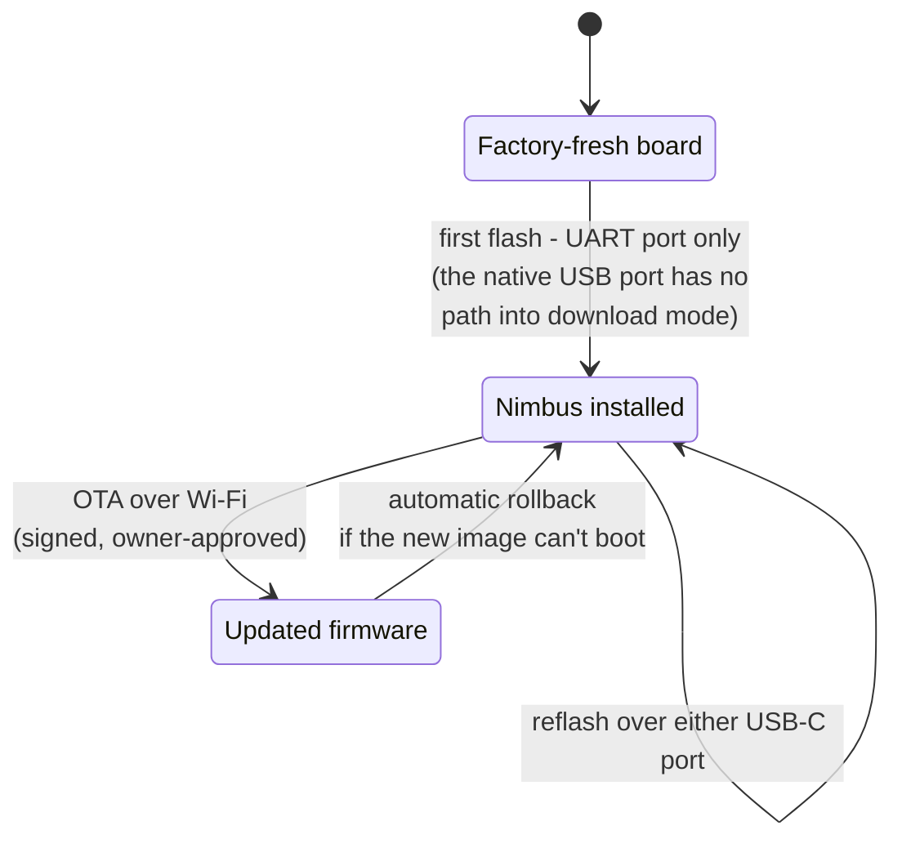
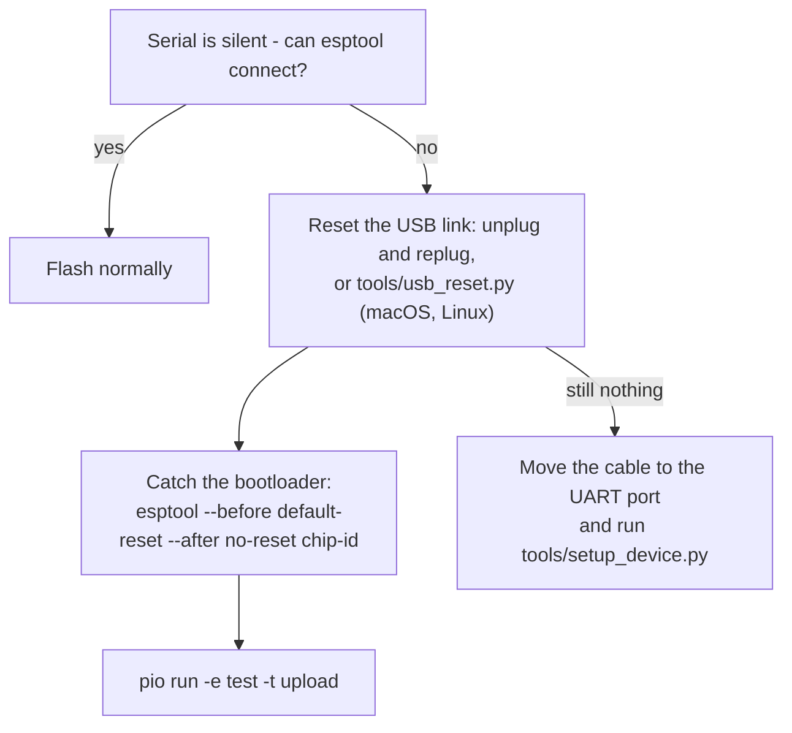

# Flash the firmware

This page puts the firmware on a new board, or back on one that needs
recovering. Two paths: the browser flasher (easiest, no toolchain), or the
command-line installer from a clone of the firmware repository.

:::caution Nimbus board: use the port labeled UART
The DevKitC-1 has **two USB-C ports and only one can flash a fresh board**.
Plug into the port silkscreened **`UART`**, not `USB`. On a factory-fresh
board the native `USB` port has **no path into download mode at all** - a
board that "won't flash" on that port is not broken, it is on the wrong port.
The Freenove CYD has a single USB-C port, so there is no wrong one to pick.
:::

## Path 1 - browser flasher (recommended)

Flash straight from a Chromium-based browser (Chrome or Edge), no toolchain
installed:

1. Connect the board to your computer with a **data-capable USB cable** (many
   cables are charge-only and never show a serial port). On the Nimbus board,
   use the port labeled **UART**; the Freenove CYD has one USB-C port.
2. Open the **[Nimbus web flasher](https://docs.cumulo-nimbus.ai/flash)** and
   **choose your board** from the list: **Nimbus board (TFT + ring)**, or the
   **Freenove CYD** at your display size (2.8, 3.5, or 4.0 inch). This is the one
   choice you must get right (see "Picking the right image" below); the Install
   button stays disabled until you pick.
3. Click **Install Nimbus** and pick the serial port when prompted: a CP210x /
   `usbserial` entry for the Nimbus board, or the board's own USB entry
   (`usbmodem` on a Mac) for the Freenove. On a new board, either answer to
   "Erase device" is fine; on a board already running Nimbus, read
   [Reinstalling from the browser](#reinstalling-from-the-browser) first.
4. **Ignore any Wi-Fi prompt the flasher shows afterwards.** You will join the
   device's own `Nimbus-setup` network in the next step, not enter Wi-Fi here.

When it finishes, the board restarts into Nimbus in **Orchestrator** mode:
join the `Nimbus-setup` Wi-Fi network and continue in the
**[setup wizard](setup-wizard.md)** (you can switch to Notifier mode later). The
image you picked already carries the display it belongs to, so **the screen
comes up right away, sized for your display**: there is no blank-screen step and
no display question in the wizard.

### Reinstalling from the browser

**A browser install always replaces the device's saved settings**, whether or
not you choose "Erase device": each image carries a fresh settings area for its
board. Wi-Fi, provider keys, the Telegram bot and the people you approved,
Bluetooth pairings, the device sign-in code, your directive, and the
assistant's scratchpad all start over, and the board comes back to the setup
network, ready for the [setup wizard](setup-wizard.md). The memory embedding
setting starts over too: if you had switched it (for example to Mistral), the
memories already stored cannot be used again without erasing them.

Without "Erase device", what the board keeps on its built-in storage stays:
routines, conversation notes, usage history, the roles you gave people (someone
you approve again gets their old role back), and, on a board without a microSD
card, its memories. "Erase device" clears all of that too. Nothing on the
microSD card is touched either way. To hand the board on or start completely
fresh, choose "Erase device", or first run **Device → Danger zone → Factory
Reset** with **Also erase storage** checked.

To update a board that already runs Nimbus and keep its settings, use an
[over-the-air update](../ota.md) or the
[command-line installer](#path-2---command-line-installer) instead. If you do
reinstall from the browser, copy your directive first (**Memory → Memory →
Directive**), have your Wi-Fi password and provider key ready to enter again,
and add the Telegram bot token back afterwards.

### On trust

The browser-flashed image is written as-is; the device does not verify it the
way it verifies [over-the-air updates](../ota.md), which are signed and checked
before they apply. To confirm the exact bytes first, each board's image and its
SHA-256 are published together, and the flasher installs the image from that
same address:

| Board | Image | SHA-256 |
|---|---|---|
| Nimbus board (TFT + ring) | [nimbus-webflash.bin](https://raw.githubusercontent.com/ristllin/nimbus-fw-releases/webflash/latest/nimbus-tft/nimbus-webflash.bin) | [nimbus-webflash.bin.sha256](https://raw.githubusercontent.com/ristllin/nimbus-fw-releases/webflash/latest/nimbus-tft/nimbus-webflash.bin.sha256) |
| Freenove CYD - 2.8 inch | [nimbus-webflash.bin](https://raw.githubusercontent.com/ristllin/nimbus-fw-releases/webflash/latest/freenove-28/nimbus-webflash.bin) | [nimbus-webflash.bin.sha256](https://raw.githubusercontent.com/ristllin/nimbus-fw-releases/webflash/latest/freenove-28/nimbus-webflash.bin.sha256) |
| Freenove CYD - 3.5 inch | [nimbus-webflash.bin](https://raw.githubusercontent.com/ristllin/nimbus-fw-releases/webflash/latest/freenove-35/nimbus-webflash.bin) | [nimbus-webflash.bin.sha256](https://raw.githubusercontent.com/ristllin/nimbus-fw-releases/webflash/latest/freenove-35/nimbus-webflash.bin.sha256) |
| Freenove CYD - 4.0 inch | [nimbus-webflash.bin](https://raw.githubusercontent.com/ristllin/nimbus-fw-releases/webflash/latest/freenove-40/nimbus-webflash.bin) | [nimbus-webflash.bin.sha256](https://raw.githubusercontent.com/ristllin/nimbus-fw-releases/webflash/latest/freenove-40/nimbus-webflash.bin.sha256) |

Save both files for your board into one folder (right-click each link and
choose Save Link As; the SHA-256 link otherwise just opens as text), or fetch
them with `curl -fLO <link>`, then check them with
`shasum -a 256 -c nimbus-webflash.bin.sha256` (macOS) or
`sha256sum -c nimbus-webflash.bin.sha256` (Linux); it prints
`nimbus-webflash.bin: OK` when the bytes match. This confirms your download is
complete and matches what is published; it does not prove who published it,
because the image and its checksum come from the same place. Over-the-air
updates are the path that checks a signature.

### Picking the right image (and what a wrong pick looks like)

The board variant is baked into the image at build time; the device does not
detect its own hardware. Each board and display size has its own image, which is
why the choice in step 2 matters. The flasher lists four:

| Choose | For | Update type it seeds |
|---|---|---|
| Nimbus board (TFT + ring) | the Solide S3 board with the 2.8" display and LED ring | `nimbus-tft` |
| Freenove CYD - 2.8 inch | the Freenove all-in-one, 2.8" display | `freenove-28` |
| Freenove CYD - 3.5 inch | the Freenove all-in-one, 3.5" display | `freenove-35` |
| Freenove CYD - 4.0 inch | the Freenove all-in-one, 4.0" display | `freenove-40` |

**What a wrong pick looks like:** an image built for the other board boots and
comes online over Wi-Fi, but its display driver drives pins that are not wired
to this board's screen, so the screen stays black even though the device looks
healthy. A wrong Freenove display size is subtler: the screen lights up but the
picture is clipped or shifted. Either way the fix is safe: reflash from this
page with the correct board selected. The choice also sets the update type, so
later over-the-air updates only ever offer the board a matching image.

## Path 2 - command-line installer

From a clone of the firmware repository, with Python 3, git, and
[PlatformIO](https://platformio.org/) installed
([Set up your computer](computer-setup.md) walks through all three):

```bash
python3 tools/setup_device.py
```

If that Python has no pyserial (common when PlatformIO came from pipx, Homebrew,
or PlatformIO's installer script), the installer re-runs itself with
PlatformIO's own Python and carries on. If it cannot find a Python with pyserial,
it stops before touching the board and prints the one command that fixes it; it
never installs with the board checks switched off.

The installer identifies the board for you and confirms before it writes:

- It **discovers connected boards** by their USB descriptor and works out the
  **board family** (Nimbus board or Freenove CYD) from that plus the saved
  settings, so you rarely need to say which board you have.
- **One board** connected? It shows what it found and asks a single question:
  `Install to '<name>' (<board family>, <configured or blank>) on <port>? [Y/n]`.
  **Several boards?** It lists them and lets you pick by number, with an
  **Identify** action (`i2`) that blinks that board's ring or screen for about
  three seconds so you can tell which is which.
- It **never erases saved settings.** An already-configured Nimbus keeps its
  Wi-Fi, keys, pairings, and device sign-in code.
- On a new board it asks for the starting **operating mode** (Notifier or
  Orchestrator), and for a Freenove the **display size** (2.8 / 3.5 / 4.0 inch).
  It seeds the display, orientation, mode, and the board's update type, verifies
  them, then installs the production firmware built for that board and display
  size.
- The first run also installs the ESP32 build tools (it prints
  `PlatformIO needs to install the ESP32 build tools first.`): about a 0.6 GB
  download and several minutes. Later runs skip this.

Useful flags: `--port` (skip discovery), `--board solide_s3|freenove_s3` (skip
autodetect), `--size 28|35|40` (Freenove display size, see below),
`--mode notifier|orchestrator` (skip the mode prompt), `--yes` (skip the confirm
prompt for CI; needs a single connected board or an explicit `--port`, plus
`--mode` for a blank board).

After it writes, the installer reads the board's serial to confirm the screen
came up, then exits. If the screen does not respond it stops with a non-zero
exit and says the wrong board variant was very likely flashed (for example a
Nimbus board image on a Freenove); the board still boots and joins the network,
so nothing else catches this. Check that the `--board` matches the hardware and
run the installer again. If a setup step fails part way, the installer restores
the production firmware first, so the board is never left on the temporary setup
image. Add `--skip-panel-check` only when you are flashing a board with no screen
attached on purpose.

### The Freenove CYD all-in-one

The [all-in-one board](../hardware/all-in-one-cyd.md) uses the **same**
installer and is auto-detected; no flag is required.

```bash
python3 tools/setup_device.py           # autodetects the Freenove on its USB-C port
python3 tools/setup_device.py --board freenove_s3 --size 35   # or be explicit
```

Two things are specific to this board:

- **One port, no UART bridge.** The CYD has a single USB-C port and rides the
  ESP32-S3's native USB the whole way, so there is no "wrong port" the way the
  DevKitC-1's two-port caution above describes. Just connect a data-capable
  USB-C cable.
- **The display size picks the image and the update type.** Each Freenove
  display size has its own image, compiled at that size's resolution, and its
  own typed update (`freenove-28` / `freenove-35` / `freenove-40`), so the board
  is only ever offered a matching image. The size prompt or `--size 28|35|40`
  chooses it; a board that is already set up keeps its saved size unless you
  pass `--size`. With `--yes`, a new board without `--size` gets the 2.8" image,
  and a set-up board whose size cannot be read is refused until you pass
  `--size`. It is always the color touchscreen, so there is no display question.
  The 3.5" and 4.0" sizes are
  [host-verified only](../hardware/all-in-one-cyd.md#supported-panels) today.

### Build without a board (optional)

To build the firmware before the board arrives, to warm up the tool download, or
on a computer that cannot reach USB (a virtual machine or a container), build the
production image for your board without flashing it:

```bash
pio run -e esp32s3          # Nimbus board (TFT + ring)
pio run -e esp32s3-cyd      # Freenove CYD, 2.8 inch
pio run -e esp32s3-cyd-35   # Freenove CYD, 3.5 inch
pio run -e esp32s3-cyd-40   # Freenove CYD, 4.0 inch
```

A successful build ends with `[SUCCESS]` and leaves the image in
`.pio/build/<environment>/firmware.bin`. The first build also downloads the
ESP32 tools; each later build takes about a minute.
Flashing still goes through `python3 tools/setup_device.py`, which reuses what
you built.

Next: the **[setup wizard](setup-wizard.md)**. The rest of this page is
reference for reflashing and recovery.

---

## The board's flashing states

A board only ever passes through three states, and the UART-vs-USB trap
exists solely on the first arrow - once Nimbus is installed, any path works:



## The two USB-C ports, explained

| Port (silkscreen) | What it is | Starts a flash by itself? |
|---|---|---|
| **UART** | CP2102N bridge, with DTR/RTS wired to the chip's reset and boot pins | **Yes - electrical, regardless of what firmware is running** |
| **USB** | The ESP32-S3's own USB peripheral | Only while the chip's ROM (or Nimbus) owns it |

On the `UART` port, esptool enters download mode electrically - no buttons.
Fresh kits ship a demo that takes over the native USB peripheral, leaving no
software path to download mode on the `USB` port; the port then shows up as a
plain CDC-ACM device whose virtual DTR/RTS do nothing. On the `UART` port the
board appears as a CP210x serial device (`/dev/cu.usbserial-*` or
`/dev/cu.SLAB_USBtoUART`).

## Reflashing a board that already runs Nimbus

Once Nimbus is on the board, **either port works** for reflashing: Nimbus
keeps the native USB port reachable (its test build has a `REBOOT` console
command, and a task watchdog restarts a hung device on its own). A typical
developer reflash:

```bash
pio run -e test -t upload       # Nimbus board; use test-cyd on a Freenove 2.8 inch
```

With more than one board connected, always pass `--upload-port` explicitly,
and confirm which board a port belongs to before flashing - the
`usbmodemNNNN` suffix tracks the computer's USB port, not the board.

## Recovery



**A silent board is almost never bricked.** If serial goes quiet *and* esptool
cannot connect on the native USB port, the usual cause is stale host-side USB
state, not the board. Unplugging the cable and plugging it back in clears it.
On macOS and Linux, `tools/usb_reset.py` does the same in software (on Windows,
replug). It needs two things, once:

- **libusb:** macOS `brew install libusb`; Ubuntu or Debian
  `sudo apt install libusb-1.0-0`; Fedora `sudo dnf install libusb1`.
- **pyusb:** nothing to install with pipx 1.4.2 or newer (check with
  `pipx --version`). With an older pipx, use a virtual environment:
  `python3 -m venv ~/.venvs/nimbus-usb && ~/.venvs/nimbus-usb/bin/pip install pyusb`.

From the firmware folder:

```bash
pipx run tools/usb_reset.py                          # pipx 1.4.2 or newer
~/.venvs/nimbus-usb/bin/python tools/usb_reset.py    # or, with the virtual environment
```

On Linux the reset needs permission on the USB device: use the
virtual-environment form with `sudo`
(`sudo ~/.venvs/nimbus-usb/bin/python tools/usb_reset.py`), so no package is
fetched as root, or install PlatformIO's udev rules, which cover Espressif's USB
ID `303a` (see the shared-computer note in
[Set up your computer](computer-setup.md#linux-allow-your-account-to-use-serial-ports)).

Either resets the USB link, the same as a replug. If something is missing, the
tool says what to install and exits without touching the bus.

This resets the USB **link**, not the chip - it un-wedges a silent serial
device but cannot restart the firmware or enter download mode by itself. With
two boards attached, disambiguate with `--serial` or `--skip` (see the
script's help).

Then, to flash, catch the board in its bootloader and hold it there (on Linux
the port is `/dev/ttyACM0` rather than `/dev/cu.usbmodem101`):

```bash
~/.platformio/penv/bin/python ~/.platformio/packages/tool-esptoolpy/esptool.py \
  --chip esp32s3 --port /dev/cu.usbmodem101 \
  --before default-reset --after no-reset chip-id
pio run -e test -t upload --upload-port /dev/cu.usbmodem101
```

Newer PlatformIO tool versions print a `DEPRECATED: 'esptool.py' is deprecated`
notice for the first command; it still works.

If the native USB port still does not respond, the `UART` port always works:
move the cable there and run `python3 tools/setup_device.py`.

:::caution Never pulse the serial control lines
Do not open the port with tools that assert DTR/RTS by default, and never
strobe those lines hoping to reset the board - on this board that can wedge
the USB device silent. The installer and the commands above already handle
the port correctly.
:::

### Recovering the device sign-in code

If a damaged or blank display prevents scanning the Sign-in QR, the device
sign-in code can be read back over the physical UART, without erasing anything:

```bash
python3 tools/setup_device.py --show-token
```

This temporarily installs the UART diagnostic, prints the code, and restores
the production firmware. It refuses to run on a board without existing Nimbus
settings. The printed code is the long, permanent one (treat it like a
password), not the short code the sign-in page asks for: open
`http://<device-address>/?t=<code>` in a private (incognito) window so it is not
kept in your browser history.

## Build environments

| Environment | Install with | What it is |
|---|---|---|
| `esp32s3` | `python3 tools/setup_device.py` | **Production firmware** for the Nimbus board. Silent serial; what a finished device runs. The installer flashes this for you. |
| `esp32s3-cyd` | `python3 tools/setup_device.py --size 28` | **Production firmware** for the Freenove CYD with the 2.8 inch display. The installer flashes this for you. |
| `esp32s3-cyd-35` | `python3 tools/setup_device.py --size 35` | **Production firmware** for the Freenove CYD with the 3.5 inch display ([host-verified only](../hardware/all-in-one-cyd.md#supported-panels)). |
| `esp32s3-cyd-40` | `python3 tools/setup_device.py --size 40` | **Production firmware** for the Freenove CYD with the 4.0 inch display ([host-verified only](../hardware/all-in-one-cyd.md#supported-panels)). |
| `test` | `pio run -e test -t upload` | Production firmware **plus a serial test console** (`STATUS`, `REBOOT`, `RENDER?`, …) for development and automated hardware tests. `test-cyd` is the same for the Freenove CYD 2.8 inch. Never the flash target for a finished device. |
| `provision` | `pio run -e provision -t upload --upload-port …` | A standalone serial **network diagnostic** - not the product firmware; it has no display UI, setup network, or web settings. `setup_device.py` uses a provisioning variant of it to seed a new board's settings, choosing the one that matches the board and the port (`provision` or `provision-uart` for a Nimbus board, `provision-cyd` for a Freenove) so its serial reply reaches the same cable. |
| `tftbringup` | `pio run -e tftbringup -t upload` | **Diagnostic only**: a bare display test (color bars, backlight fade, touch paint). It replaces the Nimbus firmware entirely - restore with `python3 tools/setup_device.py`. |

If any diagnostic environment was flashed by accident, running
`python3 tools/setup_device.py` puts the production firmware back; saved
settings are unaffected.

---

*How it works → [Hardware reference: first flash of a fresh board](../hardware.md#first-flash-of-a-fresh-board-use-the-uart-port)*
