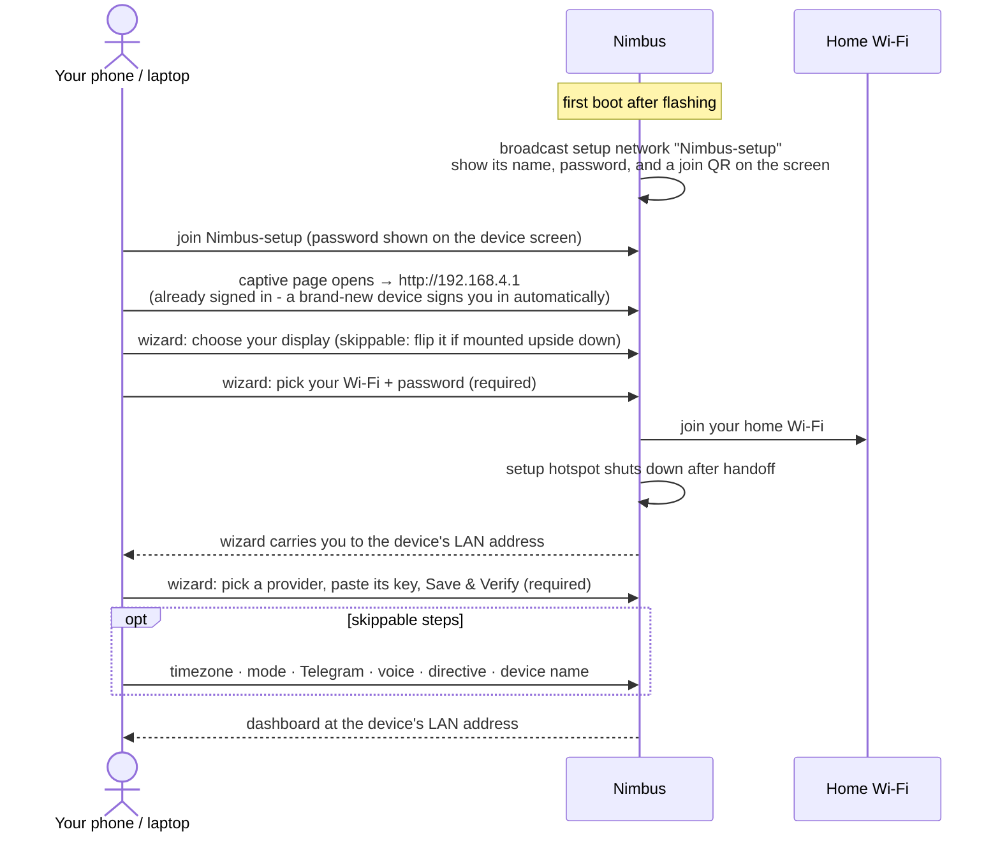

# Set up the device

From first power-on to a configured device: join the setup network, walk the
onboarding wizard, land on the dashboard. About ten minutes; no serial console.

The whole flow at a glance - every step is detailed in the sections below.
On a touchscreen board the device shuts its setup hotspot down once it is on
your Wi-Fi and the wizard follows it to the new address automatically:

## 1. Power on

Power the board over USB-C. What you see depends on the board's operating
mode. A board installed from the **browser flasher** always starts in
**Orchestrator**; the **command-line installer** asks which mode to start in.

- **Orchestrator** shows its own **setup Wi-Fi network name**, its password, and a
  QR code that joins it on the screen. Continue below.
- **Notifier** shows Bluetooth pairing guidance instead - there is no Wi-Fi
  or web UI in that mode. Jump to the
  **[Notifier quick start](notifier-quick-start.md)**.

## 2. Join the setup network

Two steps, in order - the same two the device screen shows:

1. **Join the setup network** shown on the screen:
   - **Network:** `Nimbus-setup` (a second device numbers itself
     `Nimbus-2-setup`, and so on)
   - **Password:** shown on the device screen (unique to your device) - or just
     scan the on-screen QR code to join automatically
2. **Open the setup page.** It usually opens on its own once you join. If
   nothing opens, visit `http://192.168.4.1` in your browser.

Do not use `nimbus.local` for this first hop: it is a LAN name and can resolve to
a different Nimbus. The setup page opens the wizard **already signed in**; there is
no code to copy.

## 3. Walk the wizard

The wizard asks for two required things and lets you skip the rest. It takes about
five minutes. If you close the page or the device restarts, setup picks up on this
device where you left it, at the first required step that is not done yet.

| Step | Required? | Notes |
|---|---|---|
| Choose your display | Skippable | Shown before Wi-Fi. Tick **Flip display 180 degrees** if the screen is mounted upside down; it applies right away. |
| **Connect to Wi-Fi** | Yes | Scan, pick your home network, type its password. 2.4 GHz only; SSIDs are case-sensitive. |
| **Add an AI provider** | Yes - one verified key | Pick the provider, paste its API key, click **Save & Verify**. The device checks the key with the provider before you continue. Providers: Cumulo Nimbus (preselected, recommended), Anthropic, OpenAI, Mistral, Z.ai; [Get your provider key](provider-keys.md) helps you choose. A key pasted under the wrong provider is recognized and saved under its own. A check that fails says why: the key was rejected, the account has no credit, the provider could not be reached, or the device was busy, each with the next step. Have the key ready before you start: you cannot fetch one while connected to the device's own Wi-Fi. The key stays on the device and is never shown again. |
| Your timezone | Skippable | Shows this computer's timezone (for example Europe/London) and sets the device to it with one tap, then checks the device's clock against this computer's. Routines, reminders and each day's food log follow it; a device left on UTC dates an evening meal in the wrong day for most of the world. Change it later under **Device → Mode & identity → Timezone**. |
| Choose a mode | Skippable | **Orchestrator** is the assistant, managed from this web page. **Notifier** is a Bluetooth status light: it turns Wi-Fi and this web page off, so the wizard asks you to confirm, and the way back is **Settings → Mode** on the device's screen. Applied when you finish; a mode change restarts the device. |
| Telegram | Skippable | Paste a bot token from @BotFather and click **Save & Verify**: the wizard shows the check's result and the bot it reached. It works right away, no restart. Or add it later under **Assistant → Connectors → Telegram**. |
| Voice | Skippable | Speech-to-text and text-to-speech provider: Mistral (default) or OpenAI. |
| Directive | Skippable | Standing guidance that shapes how the assistant behaves for you. Keep the default or edit it. |
| Name this device | Skippable | One name drives the setup network name, the LAN address, the Bluetooth name, and what the assistant calls itself. Applies after the next restart. |

The **Add an AI provider** step and the last step of the wizard say what the device
starts with: the provider's standard model for the assistant, its cheapest model for
helpers, photo captions, routines and the nightly dream, and a **monthly spend
ceiling of 20 USD** across all providers, after which paid calls pause until you
raise it (**Assistant > Usage**) or the month ends. The ceiling starts counting once
the device clock has synced with the internet, usually within a minute of joining
Wi-Fi, and the wizard says so while it has not. See
[Monthly spend ceiling and default models](../spend-ceiling.md).

On a **touchscreen board**, keep the wizard open while the device joins your
Wi-Fi: the setup network shuts down after handoff (to protect the display from
its own radio), and the wizard carries you to the device's new LAN address
automatically. "Home Wi-Fi connected + setup hotspot off" is the healthy end
state, not a failure.

:::note Long-term memory needs a Cumulo Nimbus, OpenAI or Mistral key
Memory turns what you share into embeddings, which only these providers make. The
device uses whichever of them you add, chosen before the first memory is stored, so
a Cumulo Nimbus key alone or a Mistral key alone gives working memory. With only an
Anthropic or Z.ai key, chat works and the wizard and the **Memory** page say that
long-term memory is off until you add one of the three.
:::

## What works with which provider

Any one verified provider runs the assistant. A few features are tied to a
specific provider or key:

| Feature | Mistral | OpenAI | Anthropic | Z.ai |
|---|---|---|---|---|
| Conversation, tools, sub-agents, routines | ✓ | ✓ | ✓ | ✓ |
| Dictation (speech-to-text) | ✓ *(default)* | ✓ | - | - |
| Spoken replies as Telegram audio (when the device cannot play them) | ✓ *(default)* | ✓ | - | - |
| Spoken replies on the device speaker | ✓ *(default)* | ✓ | - | - |
| Image generation (`image.generate`) | - | ✓ | - | - |
| Long-term memory embeddings | ✓ | ✓ | - | - |
| Web search | needs a separate **Tavily** key (Assistant → Tools → Web search) | same | same | same |

A Cumulo Nimbus key routes to these providers, so each feature works when the
matching provider is enabled for your account.

## 4. The dashboard

The wizard ends on the device's **dashboard** at its LAN address: health,
battery, memory, and sessions at a glance. The tabs are **Home**, **Chat**,
**Memory**, **Assistant** (Models, Connectors, Tools, Skills, Routines, Usage,
Safety), and **Device**. You sign in once per browser; the Sign-in QR on the
device screen gets any new browser in.

Full tab-by-tab detail: the
[web UI reference](https://docs.cumulo-nimbus.ai/getting-started/webui-reference).

Next: **[Your first conversation](first-conversation.md)**.

---

*How it works → [Orchestrator World](../orchestrator-world.md)*
